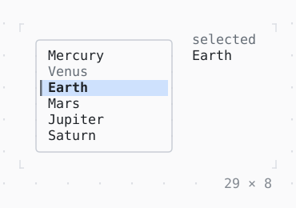

# SelectionList

Items selected by their keys: in a single selection the cursor selects, in a multiple one Space does.

| Dark | Light |
| --- | --- |
|  |  |

## Code

The Dart that builds it, as the gallery's Code tab shows it with the
options as they start:

```dart
static const _planets = [
  'Mercury',
  'Venus',
  'Earth',
  'Mars',
  'Jupiter',
  'Saturn',
  'Uranus',
  'Neptune',
];

late final _selection = SelectionController<String>(selected: ['Earth'])
  ..addListener(() => setState(() {}));

@override
void dispose() {
  _selection.dispose();
  super.dispose();
}

@override
Widget build(BuildContext context) {
  final theme = Theme.of(context);
  final selected = _selection.selected;
  return SizedBox(
    width: 29,
    height: 8,
    child: Row(
      crossAxisAlignment: .start,
      gap: 2,
      children: [
        SizedBox(
          width: 18,
          // the border primary while the list has the focus
          child: FocusBuilder(
            builder: (context, hasFocus, list) => Box(
              border: .all(
                type: .rounded,
                style: hasFocus ? theme.primary : theme.border,
              ),
              child: list,
            ),
            child: SelectionList<String>(
              itemCount: _planets.length,
              keyOf: (i) => _planets[i],
              itemBuilder: (context, i) => Text(_planets[i]),
              itemEnabled: (i) => _planets[i] != 'Venus',
              controller: _selection,
            ),
          ),
        ),
        Expanded(
          child: Text.rich([
            Span('selected\n', theme.muted),
            if (selected.isEmpty)
              Span('nothing', theme.muted)
            else
              Span(selected.join('\n')),
          ]),
        ),
      ],
    ),
  );
}
```

## Options

What the gallery lets you change, and what each starts at:

| option | values | starts at |
| --- | --- | --- |
| multiple | on, off | false |
| cursor bar | on, off | true |

## More

- API: [`SelectionList`](https://pub.dev/documentation/twk/latest/twk/SelectionList-class.html).
- Also in Controls: [Button](button.md), [Pressable](pressable.md), [Checkbox, Switch](checkbox-switch.md), [RadioGroup](radiogroup.md), [SegmentedButton](segmentedbutton.md), [Select, MultiSelect](select-multiselect.md), [ConfirmInput](confirminput.md), [Slider](slider.md), [NumberInput](numberinput.md), [DatePicker](datepicker.md), [FilePicker](filepicker.md), [Form, FormField](form-formfield.md), [TabBar, TabView](tabbar-tabview.md), [KeyHintsBar](keyhintsbar.md), [StatusMessage, Badge](statusmessage-badge.md), [Callout](callout.md), [Link](link.md), [ListTile](listtile.md), [StatusBar](statusbar.md).
- Live in the gallery:
  `dart run packages/gallery/bin/gallery.dart --route='#/controls/selectionlist'`.
- [Controls](../controls.md) · [All groups](../README.md)
