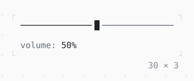

# Slider

A value along a track: the arrows, a press or a drag move the thumb, which stands in eighths of a cell.

| Dark | Light |
| --- | --- |
|  |  |

## Code

The Dart that builds it, as the gallery's Code tab shows it with the
options as they start:

```dart
var _volume = 0.5;

@override
Widget build(BuildContext context) => Column(
  mainAxisSize: .min,
  crossAxisAlignment: .start,
  gap: 1,
  children: [
    SizedBox(
      width: 30,
      child: Slider(
        value: _volume,
        semanticsLabel: 'Volume',
        onChanged: (value) => setState(() => _volume = value),
      ),
    ),
    Text.rich([
      Span('volume: ', Theme.of(context).muted),
      Span('${(_volume * 100).round()}%'),
    ]),
  ],
);
```

## Options

What the gallery lets you change, and what each starts at:

| option | values | starts at |
| --- | --- | --- |
| divisions | none, 10, 4 | none |
| width | 10 cells to 40 cells | 30 |

## More

- API: [`Slider`](https://pub.dev/documentation/twk/latest/twk/Slider-class.html).
- Also in Controls: [Button](button.md), [Pressable](pressable.md), [Checkbox, Switch](checkbox-switch.md), [RadioGroup](radiogroup.md), [SegmentedButton](segmentedbutton.md), [SelectionList](selectionlist.md), [Select, MultiSelect](select-multiselect.md), [ConfirmInput](confirminput.md), [NumberInput](numberinput.md), [DatePicker](datepicker.md), [FilePicker](filepicker.md), [Form, FormField](form-formfield.md), [TabBar, TabView](tabbar-tabview.md), [KeyHintsBar](keyhintsbar.md), [StatusMessage, Badge](statusmessage-badge.md), [Callout](callout.md), [Link](link.md), [ListTile](listtile.md), [StatusBar](statusbar.md).
- Live in the gallery:
  `dart run packages/gallery/bin/gallery.dart --route='#/controls/slider'`.
- [Controls](../controls.md) · [All groups](../README.md)
