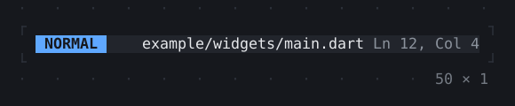
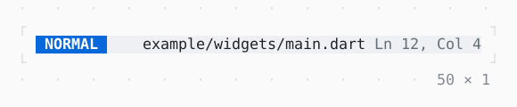

# StatusBar

A row of three sections, left, centre and right; those that do not fit give way, the centre first.

| Dark | Light |
| --- | --- |
|  |  |

## Code

The Dart that builds it, as the gallery's Code tab shows it with the
options as they start:

```dart
return SizedBox(
  width: 50,
  child: StatusBar(
    left: const Badge('NORMAL'),
    center: const Text(
      'example/widgets/main.dart',
      wrap: .none,
      overflow: .ellipsis,
    ),
    right: Text('Ln 12, Col 4', style: Theme.of(context).muted),
  ),
);
```

## Options

What the gallery lets you change, and what each starts at:

| option | values | starts at |
| --- | --- | --- |
| width | 12 cells to 50 cells | 50 |
| gap | 0, 1, 3 | 1 |

## More

- API: [`StatusBar`](https://pub.dev/documentation/twk/latest/twk/StatusBar-class.html).
- Also in Controls: [Button](button.md), [Pressable](pressable.md), [Checkbox, Switch](checkbox-switch.md), [RadioGroup](radiogroup.md), [SegmentedButton](segmentedbutton.md), [SelectionList](selectionlist.md), [Select, MultiSelect](select-multiselect.md), [ConfirmInput](confirminput.md), [Slider](slider.md), [NumberInput](numberinput.md), [DatePicker](datepicker.md), [FilePicker](filepicker.md), [Form, FormField](form-formfield.md), [TabBar, TabView](tabbar-tabview.md), [KeyHintsBar](keyhintsbar.md), [StatusMessage, Badge](statusmessage-badge.md), [Callout](callout.md), [Link](link.md), [ListTile](listtile.md).
- Live in the gallery:
  `dart run packages/gallery/bin/gallery.dart --route='#/controls/statusbar'`.
- [Controls](../controls.md) · [All groups](../README.md)
