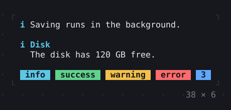
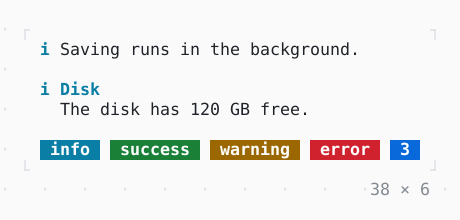

# StatusMessage, Badge

A message of a kind after its icon, in its color; a short label on its color.

| Dark | Light |
| --- | --- |
|  |  |

## Code

The Dart that builds it, as the gallery's Code tab shows it with the
options as they start:

```dart
return Column(
  mainAxisSize: .min,
  crossAxisAlignment: .start,
  gap: 1,
  children: [
    const StatusMessage('Saving runs in the background.', kind: .info),
    const StatusMessage(
      'The disk has 120 GB free.',
      kind: .info,
      title: 'Disk',
    ),
    Row(
      mainAxisSize: .min,
      gap: 1,
      children: [
        for (final kind in StatusKind.values) Badge(kind.name, kind: kind),
        const Badge('3'),
      ],
    ),
  ],
);
```

## Options

What the gallery lets you change, and what each starts at:

| option | values | starts at |
| --- | --- | --- |
| kind | info, success, warning, error | info |

## More

- API: [`StatusMessage`](https://pub.dev/documentation/twk/latest/twk/StatusMessage-class.html), [`Badge`](https://pub.dev/documentation/twk/latest/twk/Badge-class.html).
- Also in Controls: [Button](button.md), [Pressable](pressable.md), [Checkbox, Switch](checkbox-switch.md), [RadioGroup](radiogroup.md), [SegmentedButton](segmentedbutton.md), [SelectionList](selectionlist.md), [Select, MultiSelect](select-multiselect.md), [ConfirmInput](confirminput.md), [Slider](slider.md), [NumberInput](numberinput.md), [DatePicker](datepicker.md), [FilePicker](filepicker.md), [Form, FormField](form-formfield.md), [TabBar, TabView](tabbar-tabview.md), [KeyHintsBar](keyhintsbar.md), [Callout](callout.md), [Link](link.md), [ListTile](listtile.md), [StatusBar](statusbar.md).
- Live in the gallery:
  `dart run packages/gallery/bin/gallery.dart --route='#/controls/statusmessage-badge'`.
- [Controls](../controls.md) · [All groups](../README.md)
