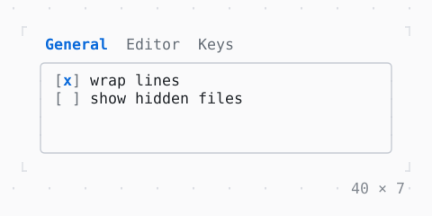

# TabBar, TabView

Tabs to pick a view by: Left and Right, or a click.

| Dark | Light |
| --- | --- |
|  |  |

## Code

The Dart that builds it, as the gallery's Code tab shows it with the
options as they start:

```dart
final _tabs = TabController(length: 3);
var _wrap = true;
var _hidden = false;
var _indent = 'spaces';

@override
void dispose() {
  _tabs.dispose();
  super.dispose();
}

@override
Widget build(BuildContext context) => SizedBox(
  width: 40,
  height: 7,
  child: Column(
    crossAxisAlignment: .stretch,
    children: [
      TabBar(controller: _tabs, tabs: const ['General', 'Editor', 'Keys']),
      Expanded(
        // the view, its border primary while the focus is in it
        child: FocusBuilder(
          builder: (context, hasFocus, view) => Box(
            border: .all(
              type: .rounded,
              style: hasFocus
                  ? Theme.of(context).primary
                  : Theme.of(context).border,
            ),
            padding: const .x(1),
            child: view,
          ),
          child: TabView(
            controller: _tabs,
            children: [
              Column(
                crossAxisAlignment: .start,
                children: [
                  Checkbox(
                    value: _wrap,
                    label: 'wrap lines',
                    onChanged: (on) => setState(() => _wrap = on),
                  ),
                  Checkbox(
                    value: _hidden,
                    label: 'show hidden files',
                    onChanged: (on) => setState(() => _hidden = on),
                  ),
                ],
              ),
              Column(
                crossAxisAlignment: .start,
                children: [
                  const Text('Indent with'),
                  RadioGroup<String>(
                    choices: const [
                      Choice('spaces', 'spaces'),
                      Choice('tabs', 'tabs'),
                    ],
                    value: _indent,
                    direction: .horizontal,
                    onChanged: (value) => setState(() => _indent = value),
                  ),
                ],
              ),
              const Text('ctrl+s saves the file.\nctrl+q quits.'),
            ],
          ),
        ),
      ),
    ],
  ),
);
```

## Options

What the gallery lets you change, and what each starts at:

| option | values | starts at |
| --- | --- | --- |
| tabs | 3, 7 | 3 |
| look | plain, strip | plain |

## More

- API: [`TabBar`](https://pub.dev/documentation/twk/latest/twk/TabBar-class.html), [`TabView`](https://pub.dev/documentation/twk/latest/twk/TabView-class.html).
- Also in Controls: [Button](button.md), [Pressable](pressable.md), [Checkbox, Switch](checkbox-switch.md), [RadioGroup](radiogroup.md), [SegmentedButton](segmentedbutton.md), [SelectionList](selectionlist.md), [Select, MultiSelect](select-multiselect.md), [ConfirmInput](confirminput.md), [Slider](slider.md), [NumberInput](numberinput.md), [DatePicker](datepicker.md), [FilePicker](filepicker.md), [Form, FormField](form-formfield.md), [KeyHintsBar](keyhintsbar.md), [StatusMessage, Badge](statusmessage-badge.md), [Callout](callout.md), [Link](link.md), [ListTile](listtile.md), [StatusBar](statusbar.md).
- Live in the gallery:
  `dart run packages/gallery/bin/gallery.dart --route='#/controls/tabbar-tabview'`.
- [Controls](../controls.md) · [All groups](../README.md)
