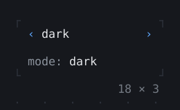
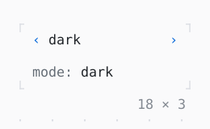

# ValueStepper

One of a few values between ‹ and ›: Left and Right or a click on an arrow step to the one before or after, stopping at the ends (`wrap: true` goes round).

| Dark | Light |
| --- | --- |
|  |  |

## Code

The Dart that builds it, as the gallery's Code tab shows it with the
options as they start:

```dart
var _mode = 'dark';

@override
Widget build(BuildContext context) {
  final theme = Theme.of(context);
  return Column(
    mainAxisSize: .min,
    crossAxisAlignment: .start,
    spacing: 1,
    children: [
      ValueStepper<String>(
        values: const [
          Choice('dark', 'dark'),
          Choice('light', 'light'),
          Choice('sepia', 'sepia', enabled: false),
          Choice('auto', 'auto-switching'),
        ],
        value: _mode,
        onChanged: (mode) => setState(() => _mode = mode),
      ),
      Text.rich([Span('mode: ', theme.muted), Span(_mode)]),
    ],
  );
}
```

## Options

What the gallery lets you change, and what each starts at:

| option | values | starts at |
| --- | --- | --- |
| enabled | on, off | true |

## More

- API: [`ValueStepper`](https://pub.dev/documentation/twk/latest/twk/ValueStepper-class.html).
- Also in Controls: [Button](button.md), [Pressable](pressable.md), [Checkbox, Switch](checkbox-switch.md), [RadioGroup](radiogroup.md), [SegmentedButton](segmentedbutton.md), [Chip, ChipList](chip-chiplist.md), [SelectionList](selectionlist.md), [Select, MultiSelect](select-multiselect.md), [ConfirmInput](confirminput.md), [Slider](slider.md), [NumberInput](numberinput.md), [DatePicker](datepicker.md), [FilePicker](filepicker.md), [Form, FormField](form-formfield.md), [TabBar, TabBarView](tabbar-tabbarview.md), [KeyHintsBar](keyhintsbar.md), [StatusMessage, Badge](statusmessage-badge.md), [Callout](callout.md), [Hyperlink](hyperlink.md), [ListTile](listtile.md), [StatusBar](statusbar.md).
- Live in the gallery:
  `dart run packages/gallery/bin/gallery.dart --route='#/controls/valuestepper'`.
- [Controls](../controls.md) · [All groups](../README.md)
