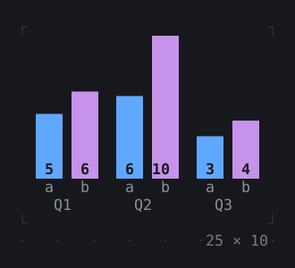
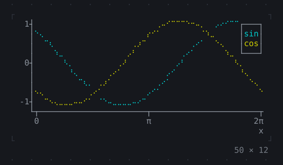
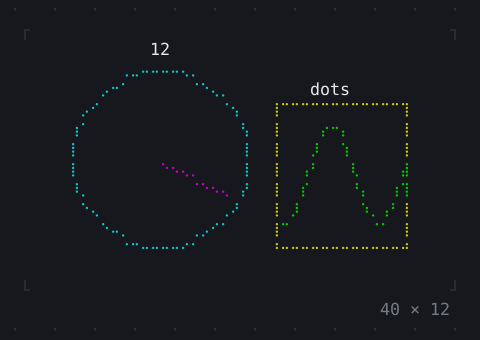
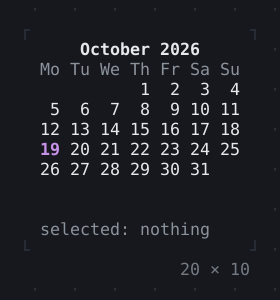
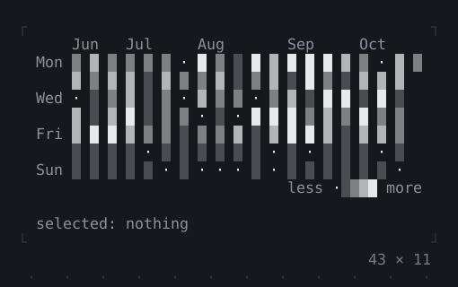
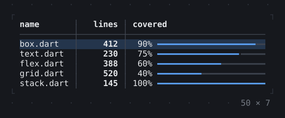
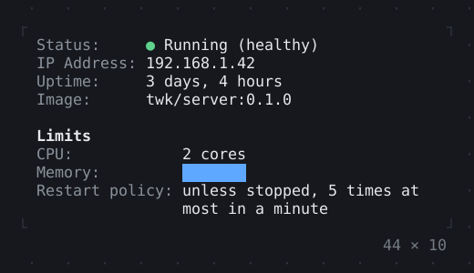
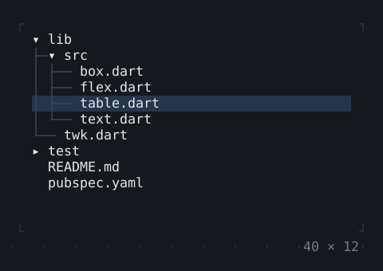
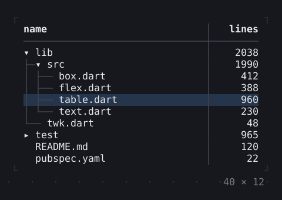
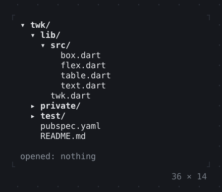

# Data

Tables, trees, charts, gauges, sparklines and calendars.

[All groups](README.md)

| | |
| --- | --- |
|  **[Sparkline](data/sparkline.md)** A series of values as bars an eighth of a cell fine, the newest on the right. |  **[Gauge, LineGauge](data/gauge-linegauge.md)** How much of something there is: a block filled to a ratio, or a line. |
|  **[BarChart](data/barchart.md)** Bars in groups, up or across, their values on them and their labels under them. |  **[Chart](data/chart.md)** Datasets of points on two axes, as lines or dots, with a legend. |
|  **[DotCanvas](data/dotcanvas.md)** Shapes drawn finer than the cells, in data coordinates, with labels over them. |  **[Calendar](data/calendar.md)** A month to pick a day of: the arrows move the cursor, PageUp and PageDown a month, Enter or a click picks the day. |
|  **[Heatmap, ActivityHeatmap](data/heatmap-activityheatmap.md)** Values over a grid as shades or colors, its rows and columns labelled; counts by day over weeks, a column a week. The arrows move a cursor, its tooltip saying what is there. |  **[Table](data/table.md)** Rows in columns that size by their content or a share, sorted by a click on a title; the arrows select a row or a cell. |
|  **[DescriptionList](data/descriptionlist.md)** Terms and their values, the values in a column of their own, aligned group by group; a long value wraps under itself, and on a narrow screen each goes under its term. |  **[TreeView](data/treeview.md)** Nodes under their parents: the arrows move and expand, Enter or a click on the expander opens one; test/ loads a while. |
|  **[TreeTable](data/treetable.md)** A tree in the first column of a table: rows that expand and collapse, sorted within their parents, selected one or many at a time. |  **[DirectoryTree](data/directorytree.md)** The files under a directory as a tree for a side panel: each directory listed as it is opened and again as it changes, what .gitignore ignores left out. |
|  **[TaskList](data/tasklist.md)** Tasks and how far they have got: pending, running with a spinner and the time it has run, done, failed or skipped; their steps below. |  |

