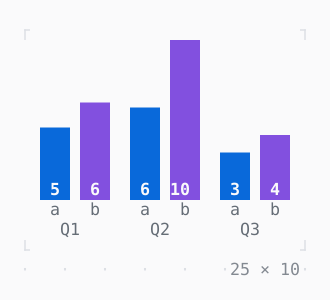

# BarChart

Bars in groups, up or across, their values on them and their labels under them.

| Dark | Light |
| --- | --- |
|  |  |

## Code

The Dart that builds it, as the gallery's Code tab shows it with the
options as they start:

```dart
const _base = [4.0, 7.0, 6.0, 9.0, 3.0, 5.0];
var _t = 0.0; // seconds

late final Timer _timer;

@override
void initState() {
  super.initState();
  _timer = Timer.periodic(
    const Duration(milliseconds: 100),
    (_) => setState(() => _t += .1),
  );
}

@override
void dispose() {
  _timer.cancel();
  super.dispose();
}

@override
Widget build(BuildContext context) {
  final theme = Theme.of(context);
  final values = [
    for (final (k, v) in _base.indexed) v + sin(_t * 1.3 + k * 1.7),
  ];
  Bar bar(int k, String label, [Style style = const Style()]) =>
      Bar(values[k], label: label, text: '${values[k].round()}', style: style);
  return SizedBox(
    width: 25,
    height: 10,
    child: BarChart(
      direction: .vertical,
      barWidth: 3,
      groupGap: 2,
      max: 10,
      barStyle: theme.primary,
      valueStyle: const .new(attrs: Attr.bold),
      labelStyle: theme.muted,
      groups: [
        for (final (g, label) in ['Q1', 'Q2', 'Q3'].indexed)
          BarGroup(
            [bar(2 * g, 'a'), bar(2 * g + 1, 'b', theme.accent)],
            label: label,
          ),
      ],
    ),
  );
}
```

## Options

What the gallery lets you change, and what each starts at:

| option | values | starts at |
| --- | --- | --- |
| direction | vertical, horizontal | vertical |
| bar width | 1, 2, 3 | 3 |
| bars | grouped, single | grouped |
| live | on, off | true |

## More

- API: [`BarChart`](https://pub.dev/documentation/twk/latest/twk/BarChart-class.html).
- Also in Data: [Sparkline](sparkline.md), [Gauge, LineGauge](gauge-linegauge.md), [Chart](chart.md), [DotCanvas](dotcanvas.md), [Calendar](calendar.md), [Heatmap, ActivityHeatmap](heatmap-activityheatmap.md), [Table](table.md), [DescriptionList](descriptionlist.md), [TreeView](treeview.md), [TreeTable](treetable.md), [DirectoryTree](directorytree.md), [TaskList](tasklist.md).
- Live in the gallery:
  `dart run packages/gallery/bin/gallery.dart --route='#/data/barchart'`.
- [Data](../data.md) · [All groups](../README.md)
