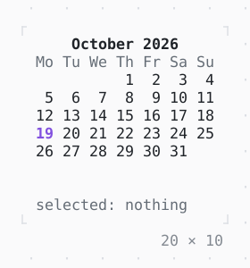

# Calendar

A month to pick a day of: the arrows move the cursor, PageUp and PageDown a month, Enter or a click picks the day.

| Dark | Light |
| --- | --- |
|  |  |

## Code

The Dart that builds it, as the gallery's Code tab shows it with the
options as they start:

```dart
DateTime? _selected;

@override
Widget build(BuildContext context) => Column(
  mainAxisSize: .min,
  crossAxisAlignment: .start,
  gap: 1,
  children: [
    Calendar(
      today: DateTime(2026, 10, 19),
      onSelected: (date) => setState(() => _selected = date),
    ),
    Text.rich([
      Span('selected: ', Theme.of(context).muted),
      switch (_selected) {
        null => Span('nothing', Theme.of(context).muted),
        final date => Span(date.toIso8601String().substring(0, 10)),
      },
    ]),
  ],
);
```

## Options

What the gallery lets you change, and what each starts at:

| option | values | starts at |
| --- | --- | --- |
| first day | monday, sunday | monday |
| week numbers | on, off | false |
| outside days | on, off | false |
| marked days | on, off | false |

## More

- API: [`Calendar`](https://pub.dev/documentation/twk/latest/twk/Calendar-class.html).
- Also in Data: [Sparkline](sparkline.md), [Gauge, LineGauge](gauge-linegauge.md), [BarChart](barchart.md), [Chart](chart.md), [DotCanvas](dotcanvas.md), [Heatmap, ActivityHeatmap](heatmap-activityheatmap.md), [Table](table.md), [DescriptionList](descriptionlist.md), [TreeView](treeview.md), [TreeTable](treetable.md), [DirectoryTree](directorytree.md), [TaskList](tasklist.md).
- Live in the gallery:
  `dart run packages/gallery/bin/gallery.dart --route='#/data/calendar'`.
- [Data](../data.md) · [All groups](../README.md)
