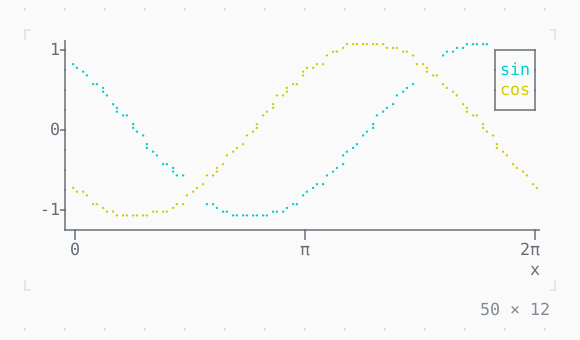

# Chart

Datasets of points on two axes, as lines or dots, with a legend.

| Dark | Light |
| --- | --- |
|  |  |

## Code

The Dart that builds it, as the gallery's Code tab shows it with the
options as they start:

```dart
var _phase = 0.0;

// the waves run to the right
late final Timer _timer;

@override
void initState() {
  super.initState();
  _timer = Timer.periodic(
    const Duration(milliseconds: 50),
    (_) => setState(() => _phase += .1),
  );
}

@override
void dispose() {
  _timer.cancel();
  super.dispose();
}

/// [f] at 61 points from 0 to 2π.
List<(double, double)> _wave(double Function(num) f) => [
  for (var i = 0; i <= 60; i++) (i * pi / 30, f(i * pi / 30 - _phase)),
];

@override
Widget build(BuildContext context) => SizedBox(
  width: 50,
  height: 12,
  child: Chart(
    marker: .braille,
    legendPosition: .topRight,
    style: Theme.of(context).muted,
    datasets: [
      Dataset(data: _wave(sin), name: 'sin', type: .line, color: .cyan),
      Dataset(data: _wave(cos), name: 'cos', type: .line, color: .yellow),
    ],
    xAxis: const ChartAxis(
      bounds: (0, 2 * pi),
      title: 'x',
      labels: ['0', 'π', '2π'],
    ),
    yAxis: const ChartAxis(bounds: (-1, 1), labels: ['-1', '0', '1']),
  ),
);
```

## Options

What the gallery lets you change, and what each starts at:

| option | values | starts at |
| --- | --- | --- |
| graph | scatter, line | line |
| marker | braille, halfBlock, quadrant, sextant, octant, block, dot, bar, custom | braille |
| legend | topLeft, top, topRight, left, right, bottomLeft, bottom, bottomRight, none | topRight |
| live | on, off | true |

## More

- API: [`Chart`](https://pub.dev/documentation/twk/latest/twk/Chart-class.html).
- Also in Data: [Sparkline](sparkline.md), [Gauge, LineGauge](gauge-linegauge.md), [BarChart](barchart.md), [DotCanvas](dotcanvas.md), [Calendar](calendar.md), [Heatmap, ActivityHeatmap](heatmap-activityheatmap.md), [Table](table.md), [DescriptionList](descriptionlist.md), [TreeView](treeview.md), [TreeTable](treetable.md), [DirectoryTree](directorytree.md), [TaskList](tasklist.md).
- Live in the gallery:
  `dart run packages/gallery/bin/gallery.dart --route='#/data/chart'`.
- [Data](../data.md) · [All groups](../README.md)
