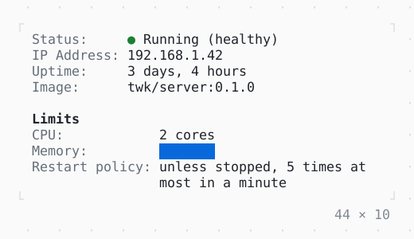

# DescriptionList

Terms and their values, the values in a column of their own, aligned group by group; a long value wraps under itself, and on a narrow screen each goes under its term.

| Dark | Light |
| --- | --- |
|  |  |

## Code

The Dart that builds it, as the gallery's Code tab shows it with the
options as they start:

```dart
final theme = Theme.of(context);
return SizedBox(
  width: 44,
  child: DescriptionList(
    items: [
      DescriptionItem(
        'Status',
        Text.rich([
          Span('● ', theme.success),
          const Span('Running (healthy)'),
        ]),
      ),
      DescriptionItem.text('IP Address', '192.168.1.42'),
      DescriptionItem.text('Uptime', '3 days, 4 hours'),
      DescriptionItem.text('Image', 'twk/server:0.1.0'),
      const DescriptionItem.group('Limits'),
      DescriptionItem.text('CPU', '2 cores'),
      const DescriptionItem('Memory', ProgressBar(value: 0.25)),
      DescriptionItem.text(
        'Restart policy',
        'unless stopped, 5 times at most in a minute',
      ),
    ],
  ),
);
```

## Options

What the gallery lets you change, and what each starts at:

| option | values | starts at |
| --- | --- | --- |
| width | 20 cells to 60 cells | 44 |
| terms | left, center, right | left |
| separator | colon, none | colon |
| groups | on, off | true |

## More

- API: [`DescriptionList`](https://pub.dev/documentation/twk/latest/twk/DescriptionList-class.html).
- Also in Data: [Sparkline](sparkline.md), [Gauge, LineGauge](gauge-linegauge.md), [BarChart](barchart.md), [Chart](chart.md), [DotCanvas](dotcanvas.md), [Calendar](calendar.md), [Heatmap, ActivityHeatmap](heatmap-activityheatmap.md), [Table](table.md), [TreeView](treeview.md), [TreeTable](treetable.md), [DirectoryTree](directorytree.md), [TaskList](tasklist.md).
- Live in the gallery:
  `dart run packages/gallery/bin/gallery.dart --route='#/data/descriptionlist'`.
- [Data](../data.md) · [All groups](../README.md)
