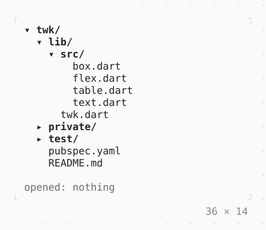

# DirectoryTree

The files under a directory as a tree for a side panel: each directory listed as it is opened and again as it changes, what .gitignore ignores left out.

| Dark | Light |
| --- | --- |
|  |  |

## Code

The Dart that builds it, as the gallery's Code tab shows it with the
options as they start:

```dart
/// A project of files as many bytes as they are big; a directory that
/// cannot be read, and what the .gitignore leaves out.
static final _files = InMemoryFileSystem(
  const ['/home/user/twk/'],
  contents: {
    '/home/user/twk/.gitignore': 'build/\n*.log\n',
    for (final (path, bytes) in const [
      ('lib/twk.dart', 312),
      ('lib/src/box.dart', 4210),
      ('lib/src/flex.dart', 9874),
      ('lib/src/table.dart', 18130),
      ('lib/src/text.dart', 2305),
      ('test/box_test.dart', 3102),
      ('test/table_test.dart', 6550),
      ('build/twk.js', 120400),
      ('.dart_tool/package_config.json', 2210),
      ('debug.log', 51200),
      ('README.md', 1204),
      ('pubspec.yaml', 220),
    ])
      '/home/user/twk/$path': 'x' * bytes,
  },
  unreadable: const ['/home/user/twk/private'],
);

final _tree = DirectoryTreeController()
  ..expand('/home/user/twk/lib')
  ..expand('/home/user/twk/lib/src');
var _opened = '';

@override
Widget build(BuildContext context) {
  final theme = Theme.of(context);
  return Column(
    mainAxisSize: .min,
    crossAxisAlignment: .start,
    gap: 1,
    children: [
      SizedBox(
        width: 36,
        height: 12,
        child: DirectoryTree(
          root: '/home/user/twk',
          fileSystem: _files,
          controller: _tree,
          onOpened: (path) => setState(
            () => _opened = path.substring('/home/user/twk/'.length),
          ),
        ),
      ),
      Text.rich([
        Span('opened: ', theme.muted),
        if (_opened.isEmpty)
          Span('nothing', theme.muted)
        else
          Span(_opened),
      ]),
    ],
  );
}
```

## Options

What the gallery lets you change, and what each starts at:

| option | values | starts at |
| --- | --- | --- |
| hidden files | on, off | false |
| .gitignore | on, off | true |
| sizes | on, off | false |
| guides | on, off | false |
| icons | none, glyphs | none |

## More

- API: [`DirectoryTree`](https://pub.dev/documentation/twk/latest/twk/DirectoryTree-class.html).
- Also in Data: [Sparkline](sparkline.md), [Gauge, LineGauge](gauge-linegauge.md), [BarChart](barchart.md), [Chart](chart.md), [DotCanvas](dotcanvas.md), [Calendar](calendar.md), [Heatmap, ActivityHeatmap](heatmap-activityheatmap.md), [Table](table.md), [DescriptionList](descriptionlist.md), [TreeView](treeview.md), [TreeTable](treetable.md), [TaskList](tasklist.md).
- Live in the gallery:
  `dart run packages/gallery/bin/gallery.dart --route='#/data/directorytree'`.
- [Data](../data.md) · [All groups](../README.md)
