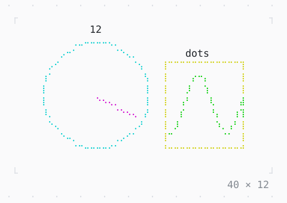

# DotCanvas

Shapes drawn finer than the cells, in data coordinates, with labels over them.

| Dark | Light |
| --- | --- |
|  |  |

## Code

The Dart that builds it, as the gallery's Code tab shows it with the
options as they start:

```dart
var _t = 0.0; // seconds

late final Timer _timer;

@override
void initState() {
  super.initState();
  _timer = Timer.periodic(
    const Duration(milliseconds: 50),
    (_) => setState(() => _t += .05),
  );
}

@override
void dispose() {
  _timer.cancel();
  super.dispose();
}

@override
Widget build(BuildContext context) {
  final hand = pi / 2 - 2 * pi * _t / 6; // a turn in 6 s
  final wave = [
    for (var i = 0; i <= 24; i++)
      (24.5 + i / 2, 10.5 + 5 * sin(i / 3 - 4 * _t)),
  ];
  return SizedBox(
    width: 40,
    height: 12,
    child: DotCanvas(
      xBounds: (0, 40),
      yBounds: (0, 24),
      marker: .braille,
      draw: (dots) => dots
        ..draw(const Shape.circle(12, 12, 9, color: .cyan))
        ..draw(
          Shape.line(
            12,
            12,
            12 + 8 * cos(hand),
            12 + 8 * sin(hand),
            color: .magenta,
          ),
        )
        ..draw(const Shape.rectangle(24, 3, 13, 15, color: .yellow))
        ..draw(Shape.polyline(wave, color: .green))
        ..layer()
        ..label(11.5, 22.6, '12')
        ..label(28, 20, 'dots'),
    ),
  );
}
```

## Options

What the gallery lets you change, and what each starts at:

| option | values | starts at |
| --- | --- | --- |
| marker | braille, halfBlock, quadrant, sextant, octant, block, dot, bar, custom | braille |
| live | on, off | true |

## More

- API: [`DotCanvas`](https://pub.dev/documentation/twk/latest/twk/DotCanvas-class.html).
- Also in Data: [Sparkline](sparkline.md), [Gauge, LineGauge](gauge-linegauge.md), [BarChart](barchart.md), [Chart](chart.md), [Calendar](calendar.md), [Heatmap, ActivityHeatmap](heatmap-activityheatmap.md), [Table](table.md), [DescriptionList](descriptionlist.md), [TreeView](treeview.md), [TreeTable](treetable.md), [DirectoryTree](directorytree.md), [TaskList](tasklist.md).
- Live in the gallery:
  `dart run packages/gallery/bin/gallery.dart --route='#/data/dotcanvas'`.
- [Data](../data.md) · [All groups](../README.md)
