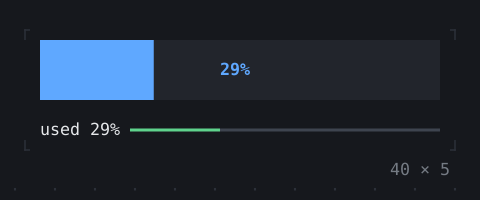
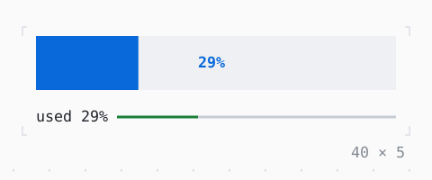

# Gauge, LineGauge

How much of something there is: a block filled to a ratio, or a line.

| Dark | Light |
| --- | --- |
|  |  |

## Code

The Dart that builds it, as the gallery's Code tab shows it with the
options as they start:

```dart
var _ratio = 0.0;

// from empty to full in 7 s, full for 2 s, and again
late final Timer _timer;

@override
void initState() {
  super.initState();
  _timer = Timer.periodic(
    const Duration(milliseconds: 25),
    (timer) {
      final ms = timer.tick * 25 % 9000;
      setState(() => _ratio = ms < 7000 ? ms / 7000 : 1);
    },
  );
}

@override
void dispose() {
  _timer.cancel();
  super.dispose();
}

@override
Widget build(BuildContext context) {
  final theme = Theme.of(context);
  final percent = '${(_ratio * 100).round()}%';
  return SizedBox(
    width: 40,
    child: Column(
      mainAxisSize: .min,
      crossAxisAlignment: .stretch,
      gap: 1,
      children: [
        SizedBox(
          height: 3,
          child: Gauge(
            ratio: _ratio,
            label: percent,
            style: theme.primary.merge(.new(bg: theme.surface.bg)),
            labelStyle: const .new(attrs: Attr.bold),
          ),
        ),
        LineGauge(
          ratio: _ratio,
          label: 'used $percent',
          type: .heavy,
          filledStyle: _ratio > .9
              ? theme.error
              : _ratio > .75
              ? theme.warning
              : theme.success,
          unfilledStyle: theme.border,
        ),
      ],
    ),
  );
}
```

## Options

What the gallery lets you change, and what each starts at:

| option | values | starts at |
| --- | --- | --- |
| live | on, off | true |
| ratio | 0% to 100% | 75 |
| line | single, heavy, double, ascii | heavy |
| label | own, percent, none | own |
| style | primary, accent, success, warning, info | primary |
| segmented | on, off | false |

## More

- API: [`Gauge`](https://pub.dev/documentation/twk/latest/twk/Gauge-class.html), [`LineGauge`](https://pub.dev/documentation/twk/latest/twk/LineGauge-class.html).
- Also in Data: [Sparkline](sparkline.md), [BarChart](barchart.md), [Chart](chart.md), [DotCanvas](dotcanvas.md), [Calendar](calendar.md), [Heatmap, ActivityHeatmap](heatmap-activityheatmap.md), [Table](table.md), [DescriptionList](descriptionlist.md), [TreeView](treeview.md), [TreeTable](treetable.md), [DirectoryTree](directorytree.md), [TaskList](tasklist.md).
- Live in the gallery:
  `dart run packages/gallery/bin/gallery.dart --route='#/data/gauge-linegauge'`.
- [Data](../data.md) · [All groups](../README.md)
