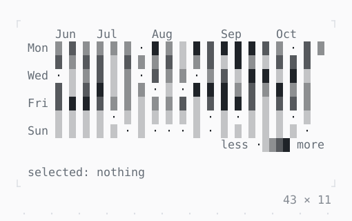

# Heatmap, ActivityHeatmap

Values over a grid as shades or colors, its rows and columns labelled; counts by day over weeks, a column a week. The arrows move a cursor, its tooltip saying what is there.

| Dark | Light |
| --- | --- |
|  |  |

## Code

The Dart that builds it, as the gallery's Code tab shows it with the
options as they start:

```dart
/// The commits of each day of the last 20 weeks: fewer at
/// the weekends.
static final _commits = {
  for (var i = 0; i < 140; i++)
    DateTime(2026, 10, 19 - i): _count(i),
};

static int _count(int i) {
  final weekend = DateTime(2026, 10, 19 - i).weekday > DateTime.friday;
  return (_noise(i) * (weekend ? 3 : 9)).floor();
}

/// A value from 0 to 1 that looks random and is the same for the same [i].
static double _noise(int i) {
  final s = sin(i * 91.345 + 3.1) * 43758.5453;
  return s - s.floorToDouble();
}

var _selected = '';

@override
Widget build(BuildContext context) {
  final theme = Theme.of(context);
  return Column(
    mainAxisSize: .min,
    crossAxisAlignment: .start,
    gap: 1,
    children: [
      ActivityHeatmap(
        counts: _commits,
        end: DateTime(2026, 10, 19),
        weeks: 20,
        showLegend: true,
        onSelected: (day) => setState(
          () => _selected = day.toIso8601String().substring(0, 10),
        ),
      ),
      Text.rich([
        Span('selected: ', theme.muted),
        if (_selected.isEmpty)
          Span('nothing', theme.muted)
        else
          Span(_selected),
      ]),
    ],
  );
}
```

## Options

What the gallery lets you change, and what each starts at:

| option | values | starts at |
| --- | --- | --- |
| widget | ActivityHeatmap, Heatmap | ActivityHeatmap |
| first day | monday, sunday | monday |
| scale | shades, colors | shades |
| legend | on, off | true |
| cell width | 2 columns, 1 column | 2 columns |

## More

- API: [`Heatmap`](https://pub.dev/documentation/twk/latest/twk/Heatmap-class.html), [`ActivityHeatmap`](https://pub.dev/documentation/twk/latest/twk/ActivityHeatmap-class.html).
- Also in Data: [Sparkline](sparkline.md), [Gauge, LineGauge](gauge-linegauge.md), [BarChart](barchart.md), [Chart](chart.md), [DotCanvas](dotcanvas.md), [Calendar](calendar.md), [Table](table.md), [DescriptionList](descriptionlist.md), [TreeView](treeview.md), [TreeTable](treetable.md), [DirectoryTree](directorytree.md), [TaskList](tasklist.md).
- Live in the gallery:
  `dart run packages/gallery/bin/gallery.dart --route='#/data/heatmap-activityheatmap'`.
- [Data](../data.md) · [All groups](../README.md)
