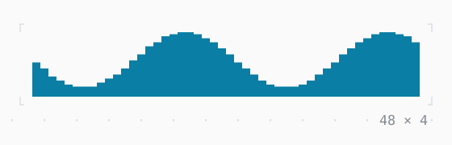

# Sparkline

A series of values as bars an eighth of a cell fine, the newest on the right.

| Dark | Light |
| --- | --- |
|  |  |

## Code

The Dart that builds it, as the gallery's Code tab shows it with the
options as they start:

```dart
var _i = 48;
var _data = [for (var i = 0; i < 48; i++) 4 + 3 * sin(i / 4)];

// a value every 150 ms, the oldest dropped
late final Timer _timer;

@override
void initState() {
  super.initState();
  _timer = Timer.periodic(
    const Duration(milliseconds: 150),
    (_) => setState(() {
      final i = _i++;
      _data = [..._data.skip(1), 4 + 3 * sin(i / 4)];
    }),
  );
}

@override
void dispose() {
  _timer.cancel();
  super.dispose();
}

@override
Widget build(BuildContext context) => SizedBox(
  width: 48,
  height: 4,
  child: Sparkline(data: _data, style: Theme.of(context).info),
);
```

## Options

What the gallery lets you change, and what each starts at:

| option | values | starts at |
| --- | --- | --- |
| data | wave, ramp, steps, noise | wave |
| rows | 1, 2, 4 | 4 |
| max | largest, 10 | largest |
| live | on, off | true |
| style | info, primary, accent, success, warning | info |

## More

- API: [`Sparkline`](https://pub.dev/documentation/twk/latest/twk/Sparkline-class.html).
- Also in Data: [Gauge, LineGauge](gauge-linegauge.md), [BarChart](barchart.md), [Chart](chart.md), [DotCanvas](dotcanvas.md), [Calendar](calendar.md), [Heatmap, ActivityHeatmap](heatmap-activityheatmap.md), [Table](table.md), [DescriptionList](descriptionlist.md), [TreeView](treeview.md), [TreeTable](treetable.md), [DirectoryTree](directorytree.md), [TaskList](tasklist.md).
- Live in the gallery:
  `dart run packages/gallery/bin/gallery.dart --route='#/data/sparkline'`.
- [Data](../data.md) · [All groups](../README.md)
