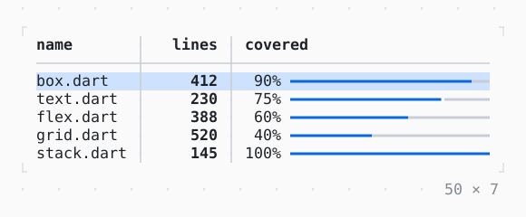

# Table

Rows in columns that size by their content or a share, sorted by a click on a title; the arrows select a row or a cell.

| Dark | Light |
| --- | --- |
|  |  |

## Code

The Dart that builds it, as the gallery's Code tab shows it with the
options as they start:

```dart
final _controller = TableController(selectedKey: 'box.dart');

@override
void dispose() {
  _controller.dispose();
  super.dispose();
}

@override
Widget build(BuildContext context) => SizedBox(
  width: 50,
  height: 7,
  child: Table<(String, int, double)>(
    rows: _files,
    rowKey: (row) => row.$1,
    controller: _controller,
    selection: .row,
    border: .single,
    columnGap: 3,
    onActivated: (row) => showToast(context, 'Activated ${row.$1}'),
    columns: [
      TableColumn(
        title: 'name',
        cell: (row) => TableCell(row.$1),
        compare: (a, b) => a.$1.compareTo(b.$1),
      ),
      TableColumn(
        title: 'lines',
        align: .right,
        cell: (row) => TableCell.rich(['${row.$2}'.bold]),
        compare: (a, b) => a.$2.compareTo(b.$2),
      ),
      TableColumn(
        title: 'covered',
        width: const .fr(1),
        cell: (row) => TableCell.widget(_Covered(row.$3)),
      ),
    ],
  ),
);

const _files = [
  ('box.dart', 412, .9),
  ('text.dart', 230, .75),
  ('flex.dart', 388, .6),
  ('grid.dart', 520, .4),
  ('stack.dart', 145, 1.0),
];

/// How much of a file its tests cover, as a line in the colours of its
/// row: the selection's and the cursor's, which the table gives a
/// widget cell's text (DefaultTextStyle).
final class _Covered extends StatelessWidget {
  const _Covered(this.ratio);

  final double ratio;

  @override
  Widget build(BuildContext context) {
    final theme = Theme.of(context);
    return LineGauge(
      ratio: ratio,
      label: '${(ratio * 100).round()}%'.padLeft(4),
      type: .heavy,
      style: DefaultTextStyle.of(context),
      filledStyle: theme.primary,
      unfilledStyle: theme.border,
    );
  }
}
```

## Options

What the gallery lets you change, and what each starts at:

| option | values | starts at |
| --- | --- | --- |
| selection | none, row, cell | row |
| border | none, single, rounded, double, heavy, ascii | single |
| header | on, off | true |
| rows | 5, 10 000 | 5 |

## More

- API: [`Table`](https://pub.dev/documentation/twk/latest/twk/Table-class.html).
- Also in Data: [Sparkline](sparkline.md), [Gauge, LineGauge](gauge-linegauge.md), [BarChart](barchart.md), [Chart](chart.md), [DotCanvas](dotcanvas.md), [Calendar](calendar.md), [Heatmap, ActivityHeatmap](heatmap-activityheatmap.md), [DescriptionList](descriptionlist.md), [TreeView](treeview.md), [TreeTable](treetable.md), [DirectoryTree](directorytree.md), [TaskList](tasklist.md).
- Live in the gallery:
  `dart run packages/gallery/bin/gallery.dart --route='#/data/table'`.
- [Data](../data.md) · [All groups](../README.md)
