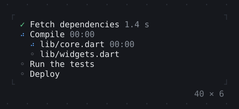
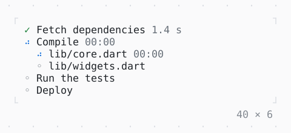

# TaskList

Tasks and how far they have got: pending, running with a spinner and the time it has run, done, failed or skipped; their steps below.

| Dark | Light |
| --- | --- |
|  |  |

## Code

The Dart that builds it, as the gallery's Code tab shows it with the
options as they start:

```dart
// what runs: 0 fetch, 1 and 2 compile, 3 test, 4 deploy, 5 done
var _step = 0;

@override
void initState() {
  super.initState();
  unawaited(_run());
}

/// The build, again and again: each step a while, then the next.
Future<void> _run() async {
  const ms = [1400, 1200, 1600, 2400, 1200, 3000];
  while (mounted) {
    for (var step = 0; step < ms.length && mounted; step++) {
      setState(() => _step = step);
      await Future<void>.delayed(Duration(milliseconds: ms[step]));
    }
  }
}

List<TaskItem> get _tasks {
  // a task that runs from step [from] to step [to]
  TaskStatus at(int from, int to) =>
      _step < from ? .pending : (_step < to ? .running : .done);
  return [
    TaskItem('Fetch dependencies', status: at(0, 1)),
    TaskItem(
      'Compile',
      status: at(1, 3),
      children: [
        TaskItem('lib/core.dart', status: at(1, 2)),
        TaskItem('lib/widgets.dart', status: at(2, 3)),
      ],
    ),
    TaskItem('Run the tests', status: at(3, 4)),
    TaskItem('Deploy', status: at(4, 5)),
  ];
}

@override
Widget build(BuildContext context) => SizedBox(
  width: 40,
  child: TaskList(
    tasks: _tasks,
  ),
);
```

## Options

What the gallery lets you change, and what each starts at:

| option | values | starts at |
| --- | --- | --- |
| step | live, fetch, compile, test, deploy, done | live |
| failed | on, off | false |
| elapsed | on, off | true |
| spinner | dots, line, arc | dots |

## More

- API: [`TaskList`](https://pub.dev/documentation/twk/latest/twk/TaskList-class.html).
- Also in Data: [Sparkline](sparkline.md), [Gauge, LineGauge](gauge-linegauge.md), [BarChart](barchart.md), [Chart](chart.md), [DotCanvas](dotcanvas.md), [Calendar](calendar.md), [Heatmap, ActivityHeatmap](heatmap-activityheatmap.md), [Table](table.md), [DescriptionList](descriptionlist.md), [TreeView](treeview.md), [TreeTable](treetable.md), [DirectoryTree](directorytree.md).
- Live in the gallery:
  `dart run packages/gallery/bin/gallery.dart --route='#/data/tasklist'`.
- [Data](../data.md) · [All groups](../README.md)
