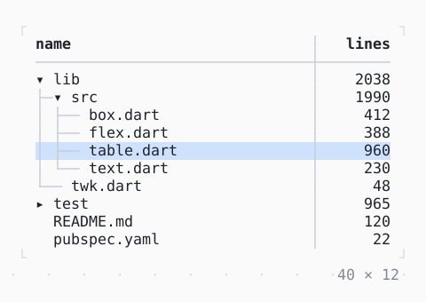

# TreeTable

A tree in the first column of a table: rows that expand and collapse, sorted within their parents, selected one or many at a time.

| Dark | Light |
| --- | --- |
|  |  |

## Code

The Dart that builds it, as the gallery's Code tab shows it with the
options as they start:

```dart
final _controller = TreeController(
  expanded: ['lib', 'lib/src'],
  selectedKey: 'lib/src/table.dart',
);

@override
void dispose() {
  _controller.dispose();
  super.dispose();
}

@override
Widget build(BuildContext context) => SizedBox(
  width: 40,
  height: 12,
  child: TreeTable<String>(
    roots: const ['lib', 'test', 'README.md', 'pubspec.yaml'],
    controller: _controller,
    selection: .row,
    border: .single,
    columnGap: 3,
    hasChildren: (path) => !path.contains('.'),
    children: (path) => _children[path] ?? const [],
    columns: [
      TableColumn(
        title: 'name',
        width: const .fr(1),
        cell: (path) => TableCell(path.split('/').last),
        compare: (a, b) => a.compareTo(b),
      ),
      TableColumn(
        title: 'lines',
        align: .right,
        cell: (path) => TableCell('${_lines(path)}'),
        compare: (a, b) => _lines(a).compareTo(_lines(b)),
      ),
    ],
  ),
);

const _children = {
  'lib': ['lib/src', 'lib/twk.dart'],
  'lib/src': [
    'lib/src/box.dart',
    'lib/src/flex.dart',
    'lib/src/table.dart',
    'lib/src/text.dart',
  ],
  'test': ['test/box_test.dart', 'test/table_test.dart'],
};

const _sizes = {
  'lib/src/box.dart': 412,
  'lib/src/flex.dart': 388,
  'lib/src/table.dart': 960,
  'lib/src/text.dart': 230,
  'lib/twk.dart': 48,
  'test/box_test.dart': 310,
  'test/table_test.dart': 655,
  'README.md': 120,
  'pubspec.yaml': 22,
};

/// A file's lines, or those of the files under a directory.
int _lines(String path) =>
    _sizes[path] ??
    (_children[path] ?? const []).fold(0, (n, p) => n + _lines(p));
```

## Options

What the gallery lets you change, and what each starts at:

| option | values | starts at |
| --- | --- | --- |
| selection | none, row, cell | row |
| border | none, single, rounded, double, heavy, ascii | single |
| guides | on, off | true |

## More

- API: [`TreeTable`](https://pub.dev/documentation/twk/latest/twk/TreeTable-class.html).
- Also in Data: [Sparkline](sparkline.md), [Gauge, LineGauge](gauge-linegauge.md), [BarChart](barchart.md), [Chart](chart.md), [DotCanvas](dotcanvas.md), [Calendar](calendar.md), [Heatmap, ActivityHeatmap](heatmap-activityheatmap.md), [Table](table.md), [DescriptionList](descriptionlist.md), [TreeView](treeview.md), [DirectoryTree](directorytree.md), [TaskList](tasklist.md).
- Live in the gallery:
  `dart run packages/gallery/bin/gallery.dart --route='#/data/treetable'`.
- [Data](../data.md) · [All groups](../README.md)
