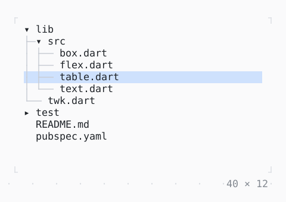

# TreeView

Nodes under their parents: the arrows move and expand, Enter or a click on the expander opens one; test/ loads a while.

| Dark | Light |
| --- | --- |
|  |  |

## Code

The Dart that builds it, as the gallery's Code tab shows it with the
options as they start:

```dart
final _controller = TreeController(
  expanded: ['lib', 'lib/src'],
  selectedKey: 'lib/src/table.dart',
);

@override
Widget build(BuildContext context) => SizedBox(
  width: 40,
  height: 12,
  child: TreeView<String>(
    roots: const ['lib', 'test', 'README.md', 'pubspec.yaml'],
    controller: _controller,
    hasChildren: (path) => !path.contains('.'),
    children: (path) => switch (path) {
      'lib' => const ['lib/src', 'lib/twk.dart'],
      'lib/src' => const [
        'lib/src/box.dart',
        'lib/src/flex.dart',
        'lib/src/table.dart',
        'lib/src/text.dart',
      ],
      'test' => Future.delayed(
        const Duration(seconds: 1),
        () => const ['test/box_test.dart', 'test/table_test.dart'],
      ),
      _ => const [],
    },
    label: (context, entry) => Text(entry.node.split('/').last),
  ),
);
```

## Options

What the gallery lets you change, and what each starts at:

| option | values | starts at |
| --- | --- | --- |
| guides | on, off | true |
| test/ | loads, fails | loads |

## More

- API: [`TreeView`](https://pub.dev/documentation/twk/latest/twk/TreeView-class.html).
- Also in Data: [Sparkline](sparkline.md), [Gauge, LineGauge](gauge-linegauge.md), [BarChart](barchart.md), [Chart](chart.md), [DotCanvas](dotcanvas.md), [Calendar](calendar.md), [Heatmap, ActivityHeatmap](heatmap-activityheatmap.md), [Table](table.md), [DescriptionList](descriptionlist.md), [TreeTable](treetable.md), [DirectoryTree](directorytree.md), [TaskList](tasklist.md).
- Live in the gallery:
  `dart run packages/gallery/bin/gallery.dart --route='#/data/treeview'`.
- [Data](../data.md) · [All groups](../README.md)
