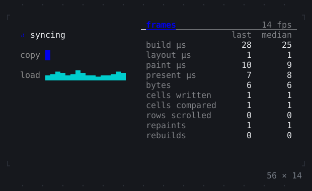

# Debugging

The log console, the frame overlay, the repaint rainbow and repaint boundaries.

[All groups](README.md)

| | |
| --- | --- |
|  **[Console](debugging/console.md)** Log records listed over the app, newest last; the app has one of its own, which Ctrl+G then c opens. |  **[FrameOverlay](debugging/frameoverlay.md)** Each frame's numbers over the app: the time its build, layout, paint and write took and the bytes it wrote; Ctrl+G then o. |
|  **[Repaint rainbow](debugging/repaint-rainbow.md)** Each repaint boundary tinted a new colour when it paints, and relayouts marked, to see what a change redraws; Ctrl+G then r, and l. |  **[RepaintBoundary](debugging/repaintboundary.md)** A subtree painted on its own layer: what changes in it is painted again without what is around it, and the other way round. |

