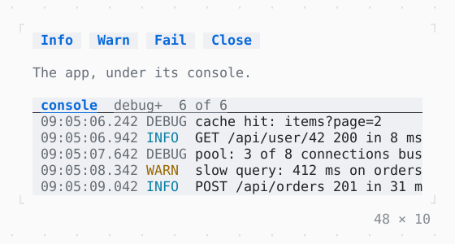

# Console

Log records listed over the app, newest last; the app has one of its own, which Ctrl+G then c opens.

| Dark | Light |
| --- | --- |
|  |  |

## Code

The Dart that builds it, as the gallery's Code tab shows it with the
options as they start:

```dart
final _sink = LogSink();
late final _console = ConsoleController(_sink)..open();
static const _traffic = [
  (LogLevel.info, 'GET /api/items 200 in 12 ms'),
  (LogLevel.debug, 'cache hit: items?page=2'),
  (LogLevel.info, 'GET /api/user/42 200 in 8 ms'),
  (LogLevel.debug, 'pool: 3 of 8 connections busy'),
  (LogLevel.warning, 'slow query: 412 ms on orders'),
  (LogLevel.info, 'POST /api/orders 201 in 31 ms'),
  (LogLevel.debug, 'cache miss: user:42:prefs'),
  (LogLevel.error, 'upstream timed out after 5 s'),
  (LogLevel.info, 'GET /api/items 200 in 15 ms'),
  (LogLevel.warning, 'retrying upload (2 of 3)'),
];
var _i = 0;
late final Timer _timer;

@override
void initState() {
  super.initState();
  // a small server's traffic, a record every 700 ms
  _timer = Timer.periodic(
    const Duration(milliseconds: 700),
    (_) {
      final (level, message) = _traffic[_i++ % _traffic.length];
      _log(level, message);
    },
  );
}

void _log(LogLevel level, String message) =>
    _sink.add(LogRecord(DateTime.now(), level, message));

@override
void dispose() {
  _timer.cancel();
  _console.dispose();
  super.dispose();
}

@override
Widget build(BuildContext context) {
  final theme = Theme.of(context);
  return SizedBox(
    width: 48,
    height: 10,
    child: KeyBindings(
      {
        'up': _console.selectPrevious,
        'down': _console.selectNext,
        'end': _console.scrollToEnd,
      },
      hints: const {'up': 'select', 'down': 'select', 'end': 'newest'},
      child: Console(
        controller: _console,
        rows: 6,
        child: Column(
          crossAxisAlignment: .start,
          gap: 1,
          children: [
            Row(
              gap: 1,
              children: [
                Button('Info', onPressed: () => _log(.info, 'all is well')),
                Button(
                  'Warn',
                  onPressed: () => _log(.warning, 'disk nearly full'),
                ),
                Button('Fail', onPressed: () => _log(.error, 'could not save')),
                ListenableBuilder(
                  listenable: _console,
                  builder: (context, _) => Button(
                    _console.isOpen ? 'Close' : 'Open',
                    onPressed: _console.toggle,
                  ),
                ),
              ],
            ),
            Text('The app, under its console.', style: theme.muted),
          ],
        ),
      ),
    ),
  );
}
```

## Options

What the gallery lets you change, and what each starts at:

| option | values | starts at |
| --- | --- | --- |
| level | debug, info, warning, error | debug |
| rows | 4, 6, 8 | 6 |
| traffic | on, off | true |
| open on error | on, off | false |

## More

- API: [`Console`](https://pub.dev/documentation/twk/latest/twk/Console-class.html).
- Also in Debugging: [FrameOverlay](frameoverlay.md), [Repaint rainbow](repaint-rainbow.md), [RepaintBoundary](repaintboundary.md).
- Live in the gallery:
  `dart run packages/gallery/bin/gallery.dart --route='#/debugging/console'`.
- [Debugging](../debugging.md) · [All groups](../README.md)
