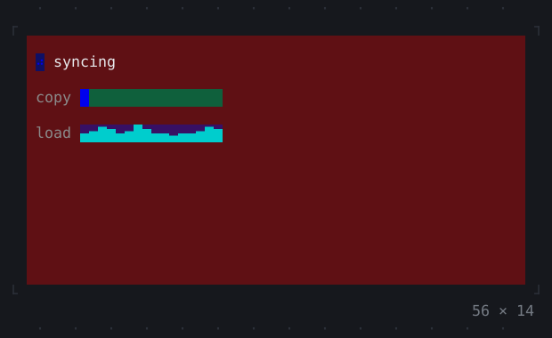
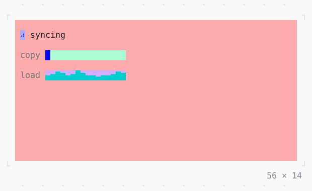

# Repaint rainbow

Each repaint boundary tinted a new colour when it paints, and relayouts marked, to see what a change redraws; Ctrl+G then r, and l.

| Dark | Light |
| --- | --- |
|  |  |

## Code

The Dart that builds it, as the gallery's Code tab shows it with the
options as they start:

```dart
import 'dart:async';

import 'package:twk/twk.dart';

// TWK_DEBUG=rainbow turns it on in any app as well
void main() => runApp(const Sync());

/// A small app whose parts change at rates of their own: the spinner each
/// 80 ms, the bar each 300 ms, the sparkline each second. Space pauses
/// the copy.
final class Sync extends StatefulWidget {
  const Sync({super.key});

  @override
  State<Sync> createState() => _SyncState();
}

final class _SyncState extends State<Sync> {
  static const _loads = <double>[3, 5, 4, 6, 8, 7, 5, 6, 9, 7, 4, 5];

  var _done = 0;
  var _samples = 0;
  var _paused = false;
  late final Timer _copy;
  late final Timer _sample;

  @override
  void initState() {
    super.initState();
    // the debug keys, Ctrl+G then r turning the rainbow on and off,
    // and l the relayout highlight
    AppBinding.of(context).debug
      ..keys = true
      ..rainbow = true;
    _copy = Timer.periodic(const Duration(milliseconds: 300), (_) {
      if (!_paused) {
        setState(() => _done = (_done + 1) % 101);
      }
    });
    _sample = Timer.periodic(
      const Duration(seconds: 1),
      (_) => setState(() => _samples++),
    );
  }

  @override
  void dispose() {
    _copy.cancel();
    _sample.cancel();
    super.dispose();
  }

  @override
  Widget build(BuildContext context) {
    final theme = Theme.of(context);
    return KeyBindings(
      {'space': () => setState(() => _paused = !_paused)},
      hints: const {'space': 'pause'},
      child: Padding(
        padding: const .all(1),
        child: Column(
          crossAxisAlignment: .start,
          gap: 1,
          children: [
            Row(
              gap: 1,
              children: [
                if (!_paused) const Spinner(),
                Text(_paused ? 'paused' : 'syncing'),
              ],
            ),
            Row(
              gap: 1,
              children: [
                Text('copy', style: theme.muted),
                SizedBox(width: 16, child: ProgressBar(value: _done / 100)),
              ],
            ),
            Row(
              gap: 1,
              children: [
                Text('load', style: theme.muted),
                SizedBox(
                  width: 16,
                  child: Sparkline(
                    data: [
                      for (var i = 0; i < 16; i++)
                        _loads[(_samples + i) % _loads.length],
                    ],
                    style: theme.info,
                  ),
                ),
              ],
            ),
          ],
        ),
      ),
    );
  }
}
```

## Options

What the gallery lets you change, and what each starts at:

| option | values | starts at |
| --- | --- | --- |
| rainbow | on, off | true |
| relayout highlight | on, off | false |

## More

- Also in Debugging: [Console](console.md), [FrameOverlay](frameoverlay.md), [RepaintBoundary](repaintboundary.md).
- Live in the gallery:
  `dart run packages/gallery/bin/gallery.dart --route='#/debugging/repaint-rainbow'`.
- [Debugging](../debugging.md) · [All groups](../README.md)
