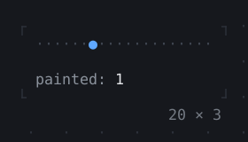
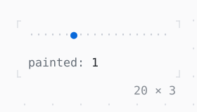

# RepaintBoundary

A subtree painted on its own layer: what changes in it is painted again without what is around it, and the other way round.

| Dark | Light |
| --- | --- |
|  |  |

## Code

The Dart that builds it, as the gallery's Code tab shows it with the
options as they start:

```dart
import 'dart:async';

import 'package:twk/twk.dart';

void main() => runApp(const Paints());

/// Dots across its cells, counting how often it paints them.
final class _Dots extends CellPainter {
  _Dots(this.style);

  final Style style;
  var paints = 0;

  @override
  void paint(Canvas canvas, int width, int height) {
    paints++;
    canvas.text(0, 0, '·' * width, style.penIn(canvas.styles));
  }

  @override
  bool shouldRepaint(_Dots oldDelegate) => false;
}

/// A dot in the column [at] says, painted again as it moves.
final class _Marker extends CellPainter {
  _Marker(this.at, this.style) : super(repaint: at);

  final ValueNotifier<int> at;
  final Style style;

  @override
  void paint(Canvas canvas, int width, int height) =>
      canvas.text(at.value, 0, '●', style.penIn(canvas.styles));

  @override
  bool shouldRepaint(_Marker oldDelegate) => false;
}

final class Paints extends StatefulWidget {
  const Paints({super.key});

  @override
  State<Paints> createState() => _PaintsState();
}

final class _PaintsState extends State<Paints> {
  final _at = ValueNotifier(0);
  late final Timer _timer;
  late final _dots = _Dots(Theme.of(context).border);

  @override
  void initState() {
    super.initState();
    // the marker a cell on: its painter repaints, no widget is built
    _timer = Timer.periodic(
      const Duration(milliseconds: 300),
      (_) => _at.value = (_at.value + 1) % 20,
    );
  }

  @override
  void dispose() {
    _timer.cancel();
    _at.dispose();
    super.dispose();
  }

  @override
  Widget build(BuildContext context) {
    final theme = Theme.of(context);
    // painted on its own, over what is under it: the dots are not
    final marker = RepaintBoundary(
      child: CustomPaint(painter: _Marker(_at, theme.primary)),
    );
    return Column(
      mainAxisSize: .min,
      crossAxisAlignment: .start,
      gap: 1,
      children: [
        CustomPaint(
          painter: _dots,
          child: SizedBox(width: 20, height: 1, child: marker),
        ),
        // the count on its own too: in a box of its size, a new one
        // lays nothing else out; in a boundary, repaints nothing else
        RepaintBoundary(
          child: SizedBox(
            width: 20,
            height: 1,
            child: ListenableBuilder(
              listenable: _at,
              builder: (context, _) => Text.rich([
                Span('painted: ', theme.muted),
                Span('${_dots.paints}'),
              ]),
            ),
          ),
        ),
      ],
    );
  }
}
```

## Options

What the gallery lets you change, and what each starts at:

| option | values | starts at |
| --- | --- | --- |
| RepaintBoundary | on, off | true |
| a step every | 300 ms, 1 s | 300 ms |

## More

- API: [`RepaintBoundary`](https://pub.dev/documentation/twk/latest/twk/RepaintBoundary-class.html).
- Also in Debugging: [Console](console.md), [FrameOverlay](frameoverlay.md), [Repaint rainbow](repaint-rainbow.md).
- Live in the gallery:
  `dart run packages/gallery/bin/gallery.dart --route='#/debugging/repaintboundary'`.
- [Debugging](../debugging.md) · [All groups](../README.md)
