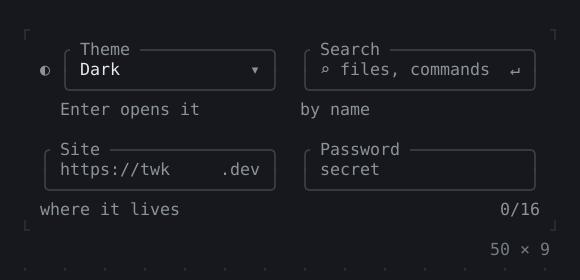

# Editing

Text fields and what is drawn around them, text areas and completion as the user types.

[All groups](README.md)

| | |
| --- | --- |
|  **[TextField](editing/textfield.md)** A line of text to edit: Tab to it and type; Enter submits it, Ctrl+Z undoes. |  **[InputDecoration](editing/inputdecoration.md)** What is drawn around a field: a label, an icon, a prefix and a suffix, a helper, an error and a counter, in a box, over a line or bare, filled. |
|  **[TextArea](editing/textarea.md)** Lines of text to edit, wrapped to the width: Enter breaks a line, the area grows from its least lines to its most, then scrolls. |  **[Autocomplete](editing/autocomplete.md)** Suggestions under a field as one types, after a trigger or for the whole text: Up and Down pick one, Enter or Tab puts it in. |

