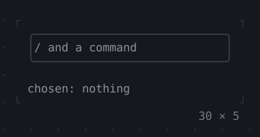
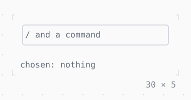

# Autocomplete

Suggestions under a field as one types, after a trigger or for the whole text: Up and Down pick one, Enter or Tab puts it in.

| Dark | Light |
| --- | --- |
|  |  |

## Code

The Dart that builds it, as the gallery's Code tab shows it with the
options as they start:

```dart
final _controller = TextEditingController();
String? _chosen;

static const _commands = {
  'help': 'the keys',
  'open': 'a file',
  'quit': 'the app',
  'save': 'the file',
  'search': 'in the files',
  'settings': 'of the app',
  'share': 'a link',
  'sort': 'the lines',
};

@override
void dispose() {
  _controller.dispose();
  super.dispose();
}

@override
Widget build(BuildContext context) {
  final theme = Theme.of(context);
  return Column(
    mainAxisSize: .min,
    crossAxisAlignment: .start,
    gap: 1,
    children: [
      // the suggestions show under the box, from its left edge
      Autocomplete(
        controller: _controller,
        trigger: '/',
        suggestions: (query) => [
          for (final MapEntry(key: command, value: detail) in _commands.entries)
            if (fuzzyMatch(query, command) != null)
              Suggestion(command, detail: detail),
        ],
        onSelected: (suggestion) => setState(() => _chosen = suggestion.text),
        child: SizedBox(
          width: 30,
          // the border primary while the focus is in it
          child: FocusBuilder(
            builder: (context, hasFocus, field) => Box(
              border: .all(
                type: .rounded,
                style: hasFocus ? theme.primary : theme.border,
              ),
              child: field,
            ),
            child: TextField(
              controller: _controller,
              placeholder: '/ and a command',
            ),
          ),
        ),
      ),
      Text.rich([
        Span('chosen: ', theme.muted),
        if (_chosen case final chosen?)
          Span(chosen)
        else
          Span('nothing', theme.muted),
      ]),
    ],
  );
}
```

## Options

What the gallery lets you change, and what each starts at:

| option | values | starts at |
| --- | --- | --- |
| trigger | /, none | / |
| rows | 8, 4 | 8 |
| popup look | raised, bordered | raised |

## More

- API: [`Autocomplete`](https://pub.dev/documentation/twk/latest/twk/Autocomplete-class.html).
- Also in Editing: [TextField](textfield.md), [InputDecoration](inputdecoration.md), [TextArea](textarea.md).
- Live in the gallery:
  `dart run packages/gallery/bin/gallery.dart --route='#/editing/autocomplete'`.
- [Editing](../editing.md) · [All groups](../README.md)
