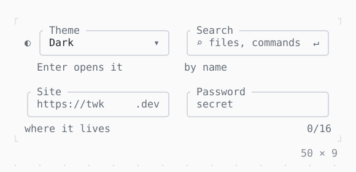

# InputDecoration

What is drawn around a field: a label, an icon, a prefix and a suffix, a helper, an error and a counter, in a box, over a line or bare, filled.

| Dark | Light |
| --- | --- |
|  |  |

## Code

The Dart that builds it, as the gallery's Code tab shows it with the
options as they start:

```dart
var _theme = 'dark';
var _password = '';

@override
Widget build(BuildContext context) {
  return Row(
    mainAxisSize: .min,
    crossAxisAlignment: .start,
    gap: 2,
    children: [
      SizedBox(
        width: 24,
        child: Column(
          mainAxisSize: .min,
          gap: 1,
          children: [
            Select<String>(
              choices: const [
                Choice('dark', 'Dark'),
                Choice('light', 'Light'),
                Choice('nord', 'Nord'),
              ],
              value: _theme,
              onChanged: (theme) => setState(() => _theme = theme),
              decoration: const InputDecoration(
                icon: Text('◐'),
                labelText: 'Theme',
                helperText: 'Enter opens it',
                border: OutlineInputBorder(),
              ),
            ),
            TextField(
              placeholder: 'twk',
              decoration: const InputDecoration(
                labelText: 'Site',
                prefixText: 'https://',
                suffixText: '.dev',
                helperText: 'where it lives',
                border: OutlineInputBorder(),
              ),
            ),
          ],
        ),
      ),
      SizedBox(
        width: 24,
        child: Column(
          mainAxisSize: .min,
          gap: 1,
          children: [
            TextField(
              placeholder: 'files, commands',
              decoration: const InputDecoration(
                labelText: 'Search',
                prefixIcon: Text('⌕'),
                suffixIcon: Text('↵'),
                helperText: 'by name',
                border: OutlineInputBorder(),
              ),
            ),
            // only the field builds again as its text changes
            StatefulBuilder(
              builder: (context, setState) => TextField(
                placeholder: 'secret',
                obscureText: true,
                // counted in the decoration: 0/16
                maxLength: 16,
                onChanged: (text) => setState(() => _password = text),
                decoration: InputDecoration(
                  labelText: 'Password',
                  errorText: _password.isNotEmpty && _password.characterCount < 8
                      ? 'at least 8 chars'
                      : null,
                  border: const OutlineInputBorder(),
                ),
              ),
            ),
          ],
        ),
      ),
    ],
  );
}
```

## Options

What the gallery lets you change, and what each starts at:

| option | values | starts at |
| --- | --- | --- |
| border | outline, underline, none | outline |
| filled | on, off | false |
| enabled | on, off | true |

## More

- API: [`InputDecoration`](https://pub.dev/documentation/twk/latest/twk/InputDecoration-class.html).
- Also in Editing: [TextField](textfield.md), [TextArea](textarea.md), [Autocomplete](autocomplete.md).
- Live in the gallery:
  `dart run packages/gallery/bin/gallery.dart --route='#/editing/inputdecoration'`.
- [Editing](../editing.md) · [All groups](../README.md)
