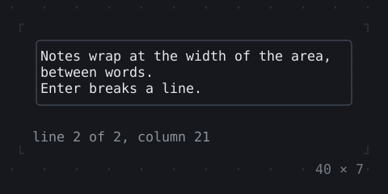
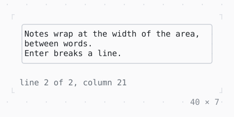

# TextArea

Lines of text to edit, wrapped to the width: Enter breaks a line, the area grows from its least lines to its most, then scrolls.

| Dark | Light |
| --- | --- |
|  |  |

## Code

The Dart that builds it, as the gallery's Code tab shows it with the
options as they start:

```dart
final _controller = TextEditingController(
  text: 'Notes wrap at the width of the area, between words.\n'
      'Enter breaks a line.',
);

@override
void dispose() {
  _controller.dispose();
  super.dispose();
}

@override
Widget build(BuildContext context) {
  final theme = Theme.of(context);
  return Column(
    mainAxisSize: .min,
    crossAxisAlignment: .start,
    gap: 1,
    children: [
      SizedBox(
        width: 40,
        // the border primary while the focus is in it
        child: FocusBuilder(
          builder: (context, hasFocus, area) => Box(
            border: .all(
              type: .rounded,
              style: hasFocus ? theme.primary : theme.border,
            ),
            child: area,
          ),
          child: TextArea(
            controller: _controller,
            placeholder: 'notes',
            minLines: 3,
            maxLines: 6,
          ),
        ),
      ),
      Column(
        mainAxisSize: .min,
        crossAxisAlignment: .start,
        children: [
          ListenableBuilder(
            listenable: _controller,
            builder: (context, _) => Text(_where(), style: theme.muted),
          ),
        ],
      ),
    ],
  );
}

/// Where the caret is: its line of the lines there are, and its
/// column, in characters.
String _where() {
  final text = _controller.text;
  final before = text.substring(0, _controller.selection.extentOffset);
  final line = '\n'.allMatches(before).length + 1;
  final lines = '\n'.allMatches(text).length + 1;
  final column = before.substring(before.lastIndexOf('\n') + 1);
  return 'line $line of $lines, column ${column.characterCount + 1}';
}
```

## Options

What the gallery lets you change, and what each starts at:

| option | values | starts at |
| --- | --- | --- |
| min lines | 1, 3 | 3 |
| max lines | none, 3, 6 | 6 |
| enter | breaks the line, submits | breaks the line |
| cursor | bar, block, underline, terminal | bar |
| blinking | on, off | false |
| read only | on, off | false |
| enabled | on, off | true |

## More

- API: [`TextArea`](https://pub.dev/documentation/twk/latest/twk/TextArea-class.html).
- Also in Editing: [TextField](textfield.md), [InputDecoration](inputdecoration.md), [Autocomplete](autocomplete.md).
- Live in the gallery:
  `dart run packages/gallery/bin/gallery.dart --route='#/editing/textarea'`.
- [Editing](../editing.md) · [All groups](../README.md)
