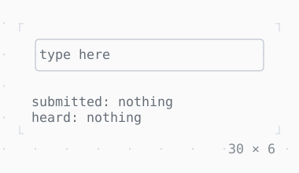

# TextField

A line of text to edit: Tab to it and type; Enter submits it, Ctrl+Z undoes.

| Dark | Light |
| --- | --- |
|  |  |

## Code

The Dart that builds it, as the gallery's Code tab shows it with the
options as they start:

```dart
var _submitted = '';
var _heard = '';

@override
Widget build(BuildContext context) {
  final theme = Theme.of(context);
  return Column(
    mainAxisSize: .min,
    crossAxisAlignment: .start,
    gap: 1,
    children: [
      SizedBox(
        width: 30,
        // the border primary while the focus is in it
        child: FocusBuilder(
          builder: (context, hasFocus, field) => Box(
            border: .all(
              type: .rounded,
              style: hasFocus ? theme.primary : theme.border,
            ),
            child: field,
          ),
          child: TextField(
            placeholder: 'type here',
            onSubmitted: (text) => setState(() => _submitted = text),
            onEditingComplete: () =>
                setState(() => _heard = 'editing complete'),
            onPaste: (text) {
              setState(
                () => _heard = 'a paste of ${text.characterCount} characters',
              );
              return false;
            },
          ),
        ),
      ),
      Column(
        mainAxisSize: .min,
        crossAxisAlignment: .start,
        children: [
          Text.rich([
            Span('submitted: ', theme.muted),
            if (_submitted.isEmpty)
              Span('nothing', theme.muted)
            else
              Span(_submitted),
          ]),
          Text.rich([
            Span('heard: ', theme.muted),
            if (_heard.isEmpty)
              Span('nothing', theme.muted)
            else
              Span(_heard),
          ]),
        ],
      ),
    ],
  );
}
```

## Options

What the gallery lets you change, and what each starts at:

| option | values | starts at |
| --- | --- | --- |
| obscured | on, off | false |
| max length | none, 8 | none |
| cursor | bar, block, underline, terminal | bar |
| blinking | on, off | false |
| text align | left, center, right, start, end | left |
| read only | on, off | false |
| enabled | on, off | true |
| a paste | goes in, taken | goes in |

## More

- API: [`TextField`](https://pub.dev/documentation/twk/latest/twk/TextField-class.html).
- Also in Editing: [InputDecoration](inputdecoration.md), [TextArea](textarea.md), [Autocomplete](autocomplete.md).
- Live in the gallery:
  `dart run packages/gallery/bin/gallery.dart --route='#/editing/textfield'`.
- [Editing](../editing.md) · [All groups](../README.md)
