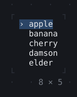
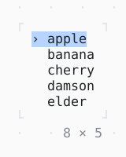

# ActiveItem

The item a focused list's keys act on: the terminal's hidden cursor rests on it, which iTerm2's cursor guide marks and macOS zoom, a screen reader or a braille display follows.

| Dark | Light |
| --- | --- |
|  |  |

## Code

The Dart that builds it, as the gallery's Code tab shows it with the
options as they start:

```dart
static const _fruits = ['apple', 'banana', 'cherry', 'damson', 'elder'];

var _cursor = 0;

void _move(int by) =>
    setState(() => _cursor = (_cursor + by).clamp(0, _fruits.length - 1));

@override
Widget build(BuildContext context) {
  final theme = Theme.of(context);
  return KeyBindings(
    {'up': () => _move(-1), 'down': () => _move(1)},
    child: Focus(
      child: Column(
        mainAxisSize: .min,
        crossAxisAlignment: .start,
        children: [
          for (var i = 0; i < _fruits.length; i++)
            // the hidden cursor on the cursor's row
            ActiveItem(
              active: i == _cursor,
              child: Text(
                i == _cursor ? '› ${_fruits[i]}' : '  ${_fruits[i]}',
                style: i == _cursor ? theme.selection : const Style(),
              ),
            ),
        ],
      ),
    ),
  );
}
```

## More

- API: [`ActiveItem`](https://pub.dev/documentation/twk/latest/twk/ActiveItem-class.html).
- Also in Focus and keys: [Focus, FocusScope](focus-focusscope.md), [ExcludeFocus](excludefocus.md), [KeyBindings, LeaderKey](keybindings-leaderkey.md), [Shortcuts, Actions](shortcuts-actions.md).
- Live in the gallery:
  `dart run packages/gallery/bin/gallery.dart --route='#/focus-and-keys/activeitem'`.
- [Focus and keys](../focus-and-keys.md) · [All groups](../README.md)
