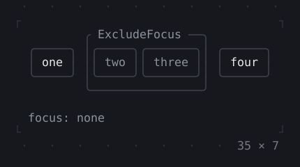
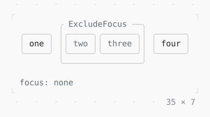

# ExcludeFocus

A subtree Tab passes by: its nodes take no focus while it excludes them, and give it up when it starts to.

| Dark | Light |
| --- | --- |
|  |  |

## Code

The Dart that builds it, as the gallery's Code tab shows it with the
options as they start:

```dart
final _nodes = [
  for (final label in ['one', 'two', 'three', 'four'])
    FocusNode(debugLabel: label),
];

@override
void dispose() {
  for (final node in _nodes) {
    node.dispose();
  }
  super.dispose();
}

@override
Widget build(BuildContext context) {
  final theme = Theme.of(context);
  final [one, two, three, four] = _nodes;
  return Column(
    mainAxisSize: .min,
    crossAxisAlignment: .start,
    gap: 1,
    children: [
      Row(
        mainAxisSize: .min,
        gap: 1,
        children: [
          _Focusable(one),
          ListenableBuilder(
            listenable: Listenable.merge([two, three]),
            builder: (context, _) {
              final inside = two.hasFocus || three.hasFocus;
              return Box(
                border: .all(
                  type: .rounded,
                  style: inside ? theme.primary : theme.border,
                ),
                titles: [
                  BorderTitle(
                    ' ExcludeFocus ',
                    style: inside ? theme.primary : theme.muted,
                  ),
                ],
                child: ExcludeFocus(
                  excluding: true,
                  child: Row(
                    mainAxisSize: .min,
                    children: [
                      _Focusable(two, muted: true),
                      _Focusable(three, muted: true),
                    ],
                  ),
                ),
              );
            },
          ),
          _Focusable(four),
        ],
      ),
      ListenableBuilder(
        listenable: Listenable.merge(_nodes),
        builder: (context, _) {
          final focused = [
            for (final node in _nodes)
              if (node.hasPrimaryFocus) node.debugLabel!,
          ];
          return Text.rich([
            Span('focus: ', theme.muted),
            if (focused.isEmpty)
              Span('none', theme.muted)
            else
              Span(focused.first, theme.primary.merge(bold)),
          ]);
        },
      ),
    ],
  );
}

/// [node] in a box that takes the focus, by Tab or a click; its label
/// [muted] while it cannot.
final class _Focusable extends StatelessWidget {
  const _Focusable(this.node, {this.muted = false});

  final FocusNode node;
  final bool muted;

  @override
  Widget build(BuildContext context) {
    final theme = Theme.of(context);
    return GestureDetector(
      onTap: (_) => node.requestFocus(),
      child: Focus(
        focusNode: node,
        child: ListenableBuilder(
          listenable: node,
          builder: (context, _) => Box(
            border: .all(
              type: node.hasFocus ? .heavy : .rounded,
              style: node.hasFocus ? theme.primary : theme.border,
            ),
            padding: const .x(1),
            child: Text(
              node.debugLabel!,
              style: muted
                  ? theme.muted
                  : (node.hasFocus ? bold : const Style()),
            ),
          ),
        ),
      ),
    );
  }
}

const bold = Style(attrs: Attr.bold);
```

## Options

What the gallery lets you change, and what each starts at:

| option | values | starts at |
| --- | --- | --- |
| excluding | on, off | true |

## More

- API: [`ExcludeFocus`](https://pub.dev/documentation/twk/latest/twk/ExcludeFocus-class.html).
- Also in Focus and keys: [Focus, FocusScope](focus-focusscope.md), [KeyBindings, LeaderKey](keybindings-leaderkey.md), [Shortcuts, Actions](shortcuts-actions.md).
- Live in the gallery:
  `dart run packages/gallery/bin/gallery.dart --route='#/focus-and-keys/excludefocus'`.
- [Focus and keys](../focus-and-keys.md) · [All groups](../README.md)
