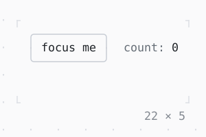

# KeyBindings, LeaderKey

Keys and sequences bound to callbacks while the focus is below them: Tab to the box, then +, -, g g or the leader , and r.

| Dark | Light |
| --- | --- |
|  |  |

## Code

The Dart that builds it, as the gallery's Code tab shows it with the
options as they start:

```dart
final _node = FocusNode(debugLabel: 'focus me');
var _count = 0;

void _add(int n) => setState(() => _count += n);

void _reset() => setState(() => _count = 0);

@override
void dispose() {
  _node.dispose();
  super.dispose();
}

@override
Widget build(BuildContext context) {
  final theme = Theme.of(context);
  return LeaderKey(
    ',',
    child: KeyBindings(
      {
        '+': () => _add(1),
        '-': () => _add(-1),
        'g g': _reset,
        'leader r': _reset,
      },
      hints: const {
        '+': 'more',
        '-': 'less',
        'g g': 'reset',
        'leader r': 'reset',
      },
      child: Column(
        mainAxisSize: .min,
        crossAxisAlignment: .start,
        gap: 1,
        children: [
          Row(
            mainAxisSize: .min,
            gap: 2,
            children: [
              _Focusable(_node),
              Text.rich([Span('count: ', theme.muted), Span('$_count')]),
            ],
          ),
          const KeyHintsBar(),
        ],
      ),
    ),
  );
}

/// [node] in a box that takes the focus, by Tab or a click.
final class _Focusable extends StatelessWidget {
  const _Focusable(this.node);

  final FocusNode node;

  @override
  Widget build(BuildContext context) {
    final theme = Theme.of(context);
    return GestureDetector(
      onTap: (_) => node.requestFocus(),
      child: Focus(
        focusNode: node,
        child: ListenableBuilder(
          listenable: node,
          builder: (context, _) => Box(
            border: .all(
              type: node.hasFocus ? .heavy : .rounded,
              style: node.hasFocus ? theme.primary : theme.border,
            ),
            padding: const .x(1),
            child: Text(
              node.debugLabel!,
              style: node.hasFocus ? bold : const Style(),
            ),
          ),
        ),
      ),
    );
  }
}

const bold = Style(attrs: Attr.bold);
```

## Options

What the gallery lets you change, and what each starts at:

| option | values | starts at |
| --- | --- | --- |
| leader | ,, space, \ | , |
| sequence timeout | 1 s, none | 1 s |
| unmatched keys | drop, replay | drop |

## More

- API: [`KeyBindings`](https://pub.dev/documentation/twk/latest/twk/KeyBindings-class.html), [`LeaderKey`](https://pub.dev/documentation/twk/latest/twk/LeaderKey-class.html).
- Also in Focus and keys: [Focus, FocusScope](focus-focusscope.md), [ExcludeFocus](excludefocus.md), [Shortcuts, Actions](shortcuts-actions.md).
- Live in the gallery:
  `dart run packages/gallery/bin/gallery.dart --route='#/focus-and-keys/keybindings-leaderkey'`.
- [Focus and keys](../focus-and-keys.md) · [All groups](../README.md)
