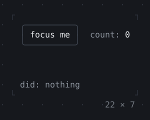
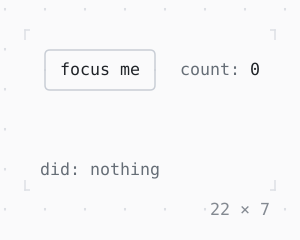

# Shortcuts, Actions

Keys bound to intents, which the nearest action for them does: Tab to the box, then Up or Down; a key whose action is off passes on.

| Dark | Light |
| --- | --- |
|  |  |

## Code

The Dart that builds it, as the gallery's Code tab shows it with the
options as they start:

```dart
/// Steps up a count.
final class _Up extends Intent {
  const _Up();
}

/// Steps down a count.
final class _Down extends Intent {
  const _Down();
}

final _node = FocusNode(debugLabel: 'focus me');
var _count = 0;
var _did = '';

void _step(int n, String did) => setState(() {
  _count += n;
  _did = did;
});

void _passed(String did) => setState(() => _did = did);

@override
void dispose() {
  _node.dispose();
  super.dispose();
}

@override
Widget build(BuildContext context) {
  final theme = Theme.of(context);
  // the keys no enabled action takes come here
  return KeyBindings(
    {
      'up': () => _passed('↑ _Up → passed on to the KeyBindings'),
      'down': () => _passed('↓ _Down → passed on to the KeyBindings'),
    },
    hints: const {'up': 'passed on', 'down': 'passed on'},
    child: Actions(
      {
        _Up: CallbackAction<_Up>(
          onInvoke: (_) => _step(1, '↑ _Up → its action stepped up'),
        ),
        _Down: CallbackAction<_Down>(
          onInvoke: (_) => _step(-1, '↓ _Down → its action stepped down'),
        ),
      },
      child: Shortcuts(
        const {'up': _Up(), 'down': _Down()},
        hints: const {'up': 'step up', 'down': 'step down'},
        child: Column(
          mainAxisSize: .min,
          crossAxisAlignment: .start,
          gap: 1,
          children: [
            Row(
              mainAxisSize: .min,
              gap: 2,
              children: [
                _Focusable(_node),
                Text.rich([Span('count: ', theme.muted), Span('$_count')]),
              ],
            ),
            KeyHintsBar(
              keyLabel: (key) => switch ('$key') {
                'up' => '↑',
                'down' => '↓',
                final name => name,
              },
            ),
            Text.rich([
              Span('did: ', theme.muted),
              if (_did.isEmpty) Span('nothing', theme.muted) else Span(_did),
            ]),
          ],
        ),
      ),
    ),
  );
}

/// [node] in a box that takes the focus, by Tab or a click.
final class _Focusable extends StatelessWidget {
  const _Focusable(this.node);

  final FocusNode node;

  @override
  Widget build(BuildContext context) {
    final theme = Theme.of(context);
    return GestureDetector(
      onTap: (_) => node.requestFocus(),
      child: Focus(
        focusNode: node,
        child: ListenableBuilder(
          listenable: node,
          builder: (context, _) => Box(
            border: .all(
              type: node.hasFocus ? .heavy : .rounded,
              style: node.hasFocus ? theme.primary : theme.border,
            ),
            padding: const .x(1),
            child: Text(
              node.debugLabel!,
              style: node.hasFocus ? bold : const Style(),
            ),
          ),
        ),
      ),
    );
  }
}

const bold = Style(attrs: Attr.bold);
```

## Options

What the gallery lets you change, and what each starts at:

| option | values | starts at |
| --- | --- | --- |
| actions enabled | on, off | true |

## More

- API: [`Shortcuts`](https://pub.dev/documentation/twk/latest/twk/Shortcuts-class.html), [`Actions`](https://pub.dev/documentation/twk/latest/twk/Actions-class.html).
- Also in Focus and keys: [Focus, FocusScope](focus-focusscope.md), [ExcludeFocus](excludefocus.md), [KeyBindings, LeaderKey](keybindings-leaderkey.md).
- Live in the gallery:
  `dart run packages/gallery/bin/gallery.dart --route='#/focus-and-keys/shortcuts-actions'`.
- [Focus and keys](../focus-and-keys.md) · [All groups](../README.md)
