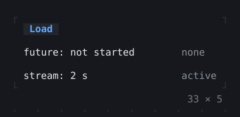
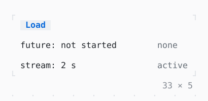

# FutureBuilder, StreamBuilder

What is built from the latest snapshot of a future or a stream: waiting, done, or each event.

| Dark | Light |
| --- | --- |
|  |  |

## Code

The Dart that builds it, as the gallery's Code tab shows it with the
options as they start:

```dart
Future<String>? _load;
final Stream<int> _ticks = Stream.periodic(
  const Duration(seconds: 1),
  (i) => i + 1,
);

void _start() => setState(
  () => _load = Future.delayed(
    const Duration(seconds: 2),
    () => 'loaded',
  ),
);

@override
Widget build(BuildContext context) {
  final theme = Theme.of(context);
  Widget shown(Widget what, AsyncSnapshot<Object?> snapshot) => Row(
    mainAxisSize: .min,
    gap: 1,
    children: [
      SizedBox(width: 26, child: what),
      Text(snapshot.connectionState.name, style: theme.muted),
    ],
  );
  return Column(
    mainAxisSize: .min,
    crossAxisAlignment: .start,
    gap: 1,
    children: [
      Button('Load', onPressed: _start),
      FutureBuilder<String>(
        future: _load,
        builder: (context, snapshot) => shown(
          switch (snapshot.connectionState) {
            ConnectionState.none => const Text('future: not started'),
            ConnectionState.waiting => Row(
              gap: 1,
              children: [
                const Text('future:'),
                const Spinner(),
              ],
            ),
            _ when snapshot.hasError => Text(
              'future: ${snapshot.error}',
              style: theme.error,
            ),
            _ => Text('future: ${snapshot.data}', style: theme.success),
          },
          snapshot,
        ),
      ),
      StreamBuilder<int>(
        stream: _ticks,
        builder: (context, snapshot) =>
            shown(Text('stream: ${snapshot.data ?? 0} s'), snapshot),
      ),
    ],
  );
}
```

## Options

What the gallery lets you change, and what each starts at:

| option | values | starts at |
| --- | --- | --- |
| future | value, error | value |
| stream | endless, take(5) | endless |

## More

- API: [`FutureBuilder`](https://pub.dev/documentation/twk/latest/twk/FutureBuilder-class.html), [`StreamBuilder`](https://pub.dev/documentation/twk/latest/twk/StreamBuilder-class.html).
- Also in Foundation: [ListenableBuilder](listenablebuilder.md).
- Live in the gallery:
  `dart run packages/gallery/bin/gallery.dart --route='#/foundation/futurebuilder-streambuilder'`.
- [Foundation](../foundation.md) · [All groups](../README.md)
