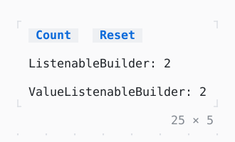

# ListenableBuilder

What is built again each time a listenable notifies; ValueListenableBuilder is given its value.

| Dark | Light |
| --- | --- |
|  |  |

## Code

The Dart that builds it, as the gallery's Code tab shows it with the
options as they start:

```dart
final _count = ValueNotifier<int>(0);
late final Timer _timer;

@override
void initState() {
  super.initState();
  // one more each second
  _timer = Timer.periodic(
    const Duration(seconds: 1),
    (_) => _count.value++,
  );
}

@override
void dispose() {
  _timer.cancel();
  _count.dispose();
  super.dispose();
}

@override
Widget build(BuildContext context) => Column(
  mainAxisSize: .min,
  crossAxisAlignment: .start,
  gap: 1,
  children: [
    Row(
      mainAxisSize: .min,
      gap: 2,
      children: [
        Button('Count', onPressed: () => _count.value++),
        // notifies no one when it is 0 already
        Button('Reset', onPressed: () => _count.value = 0),
      ],
    ),
    ListenableBuilder(
      listenable: _count,
      builder: (context, _) => Text('ListenableBuilder: ${_count.value}'),
    ),
    ValueListenableBuilder(
      valueListenable: _count,
      builder: (context, value, _) => Text('ValueListenableBuilder: $value'),
    ),
  ],
);
```

## Options

What the gallery lets you change, and what each starts at:

| option | values | starts at |
| --- | --- | --- |
| timer | on, off | true |

## More

- API: [`ListenableBuilder`](https://pub.dev/documentation/twk/latest/twk/ListenableBuilder-class.html).
- Also in Foundation: [FutureBuilder, StreamBuilder](futurebuilder-streambuilder.md).
- Live in the gallery:
  `dart run packages/gallery/bin/gallery.dart --route='#/foundation/listenablebuilder'`.
- [Foundation](../foundation.md) · [All groups](../README.md)
