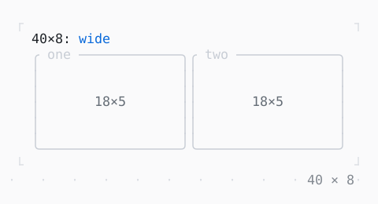

# LayoutBuilder

What is built by the constraints it is laid out within: side by side when wide, one under another when narrow.

| Dark | Light |
| --- | --- |
|  |  |

## Code

The Dart that builds it, as the gallery's Code tab shows it with the
options as they start:

```dart
final theme = Theme.of(context);
return SizedBox(
  width: 40,
  height: 8,
  // a render object widget: its builder runs in the layout, with the
  // constraints the SizedBox gives, and again when they change
  child: LayoutBuilder(
    builder: (context, constraints) {
      final wide = constraints.maxW >= 30;
      final panes = [
        for (final name in const ['one', 'two'])
          Expanded(
            child: Box(
              border: .all(type: .rounded, style: theme.border),
              titles: [BorderTitle(' $name ')],
              // what each pane is given in turn
              child: LayoutBuilder(
                builder: (context, constraints) => Center(
                  child: Text(
                    describeConstraints(constraints),
                    style: theme.muted,
                  ),
                ),
              ),
            ),
          ),
      ];
      return Column(
        crossAxisAlignment: .stretch,
        children: [
          Text.rich([
            Span('${describeConstraints(constraints)}: '),
            Span(wide ? 'wide' : 'narrow', theme.primary),
          ]),
          Expanded(
            child: wide
                ? Row(crossAxisAlignment: .stretch, children: panes)
                : Column(crossAxisAlignment: .stretch, children: panes),
          ),
        ],
      );
    },
  ),
);
```

## Options

What the gallery lets you change, and what each starts at:

| option | values | starts at |
| --- | --- | --- |
| width | 12 cells to 50 cells | 40 |
| wide from | 24, 30, 36 | 30 |

## More

- API: [`LayoutBuilder`](https://pub.dev/documentation/twk/latest/twk/LayoutBuilder-class.html).
- Also in Framework: [NotificationListener](notificationlistener.md), [Slot, SlotScope](slot-slotscope.md).
- Live in the gallery:
  `dart run packages/gallery/bin/gallery.dart --route='#/framework/layoutbuilder'`.
- [Framework](../framework.md) · [All groups](../README.md)
