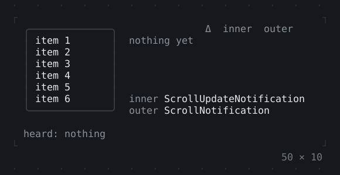
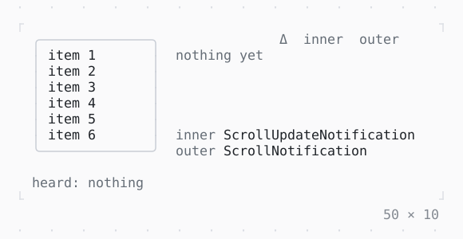

# NotificationListener

The notifications that bubble up to it from below, such as those of a list as it scrolls: the wheel over it, or Tab to it and the arrows.

| Dark | Light |
| --- | --- |
|  |  |

## Code

The Dart that builds it, as the gallery's Code tab shows it with the
options as they start:

```dart
/// What became of a notification on its way up the tree.
final class _Sent {
  _Sent(this.notification);

  final ScrollNotification notification;

  // what the inner and the outer listener did with it
  var inner = 'past';
  String? _outer;

  String get outer => _outer ?? (inner == 'stops' ? '–' : 'past');
  set outer(String what) => _outer = what;
}

final _trace = <_Sent>[];
String? _heard;

// the list's, so that its box shows where the focus is
final _list = FocusNode();

@override
void dispose() {
  _list.dispose();
  super.dispose();
}

// nearest the list: hears each one first, and lets it go on up
bool _onSent(ScrollNotification notification) {
  setState(() => _trace.add(_Sent(notification)));
  return false;
}

bool _onInner(ScrollUpdateNotification notification) {
  _trace.last.inner = 'heard';
  return false; // lets it go on up
}

bool _onOuter(ScrollNotification notification) {
  final ScrollMetrics(:offset, :maxOffset) = notification.metrics;
  setState(() {
    _trace.last.outer = 'heard';
    _heard = switch (notification) {
      ScrollUpdateNotification(:final scrollDelta) =>
        'scrolled $scrollDelta to $offset of $maxOffset',
      OverscrollNotification(:final overscroll) =>
        'overscrolled $overscroll at $offset of $maxOffset',
      _ => '$notification',
    };
  });
  return false;
}

@override
Widget build(BuildContext context) {
  final theme = Theme.of(context);
  return SizedBox(
    width: 50,
    child: Column(
      mainAxisSize: .min,
      crossAxisAlignment: .start,
      gap: 1,
      children: [
        Row(
          crossAxisAlignment: .start,
          gap: 2,
          children: [
            SizedBox(
              width: 16,
              height: 8,
              // proxy widgets: they draw nothing, and hear what bubbles up
              child: NotificationListener<ScrollNotification>(
                onNotification: _onOuter,
                child: NotificationListener<ScrollUpdateNotification>(
                  onNotification: _onInner,
                  child: ListenableBuilder(
                    listenable: _list,
                    builder: (context, list) => Box(
                      border: .all(
                        type: .rounded,
                        style: _list.hasFocus ? theme.primary : theme.border,
                      ),
                      padding: const .x(1),
                      child: list,
                    ),
                    child: NotificationListener<ScrollNotification>(
                      onNotification: _onSent,
                      child: ListView.builder(
                        focusNode: _list,
                        itemCount: 100,
                        itemBuilder: (context, i) => Text('item ${i + 1}'),
                      ),
                    ),
                  ),
                ),
              ),
            ),
            Expanded(
              child: _Trace([..._trace.reversed.take(4)].reversed),
            ),
          ],
        ),
        Text.rich([
          Span('heard: ', theme.muted),
          switch (_heard) {
            null => Span('nothing', theme.muted),
            final heard => Span(heard),
          },
        ]),
      ],
    ),
  );
}

/// The notifications sent up, newest last: their kind, how far, and
/// what the inner and the outer listener did with them.
final class _Trace extends StatelessWidget {
  const _Trace(this.sent);

  final Iterable<_Sent> sent;

  @override
  Widget build(BuildContext context) {
    final theme = Theme.of(context);
    Style mark(String what) => switch (what) {
      'heard' => theme.success,
      'stops' => theme.warning,
      _ => theme.muted,
    };
    String signed(int n) => (n > 0 ? '+$n' : '$n').padLeft(3);
    return SizedBox(
      height: 8,
      child: Column(
        crossAxisAlignment: .start,
        children: [
          Text('             Δ  inner  outer', style: theme.muted),
          if (sent.isEmpty) Text('nothing yet', style: theme.muted),
          for (final s in sent)
            Text.rich([
              Span(switch (s.notification) {
                ScrollUpdateNotification(:final scrollDelta) =>
                  'update     ${signed(scrollDelta)}',
                OverscrollNotification(:final overscroll) =>
                  'overscroll ${signed(overscroll)}',
                _ => '',
              }),
              Span('  ${s.inner.padRight(7)}', mark(s.inner)),
              Span(s.outer, mark(s.outer)),
            ]),
          const Spacer(),
          Text.rich([
            Span('inner ', theme.muted),
            const Span('ScrollUpdateNotification'),
          ]),
          Text.rich([
            Span('outer ', theme.muted),
            const Span('ScrollNotification'),
          ]),
        ],
      ),
    );
  }
}
```

## Options

What the gallery lets you change, and what each starts at:

| option | values | starts at |
| --- | --- | --- |
| outer hears | Scroll, ScrollUpdate, Overscroll | Scroll |
| inner stops them | on, off | false |

## More

- API: [`NotificationListener`](https://pub.dev/documentation/twk/latest/twk/NotificationListener-class.html).
- Also in Framework: [LayoutBuilder](layoutbuilder.md), [Slot, SlotScope](slot-slotscope.md).
- Live in the gallery:
  `dart run packages/gallery/bin/gallery.dart --route='#/framework/notificationlistener'`.
- [Framework](../framework.md) · [All groups](../README.md)
