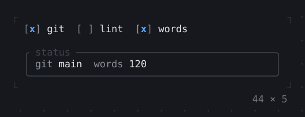
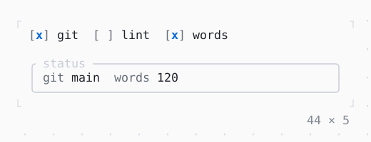

# Slot, SlotScope

Places the app names that plugins fill with the entries of a SlotRegistry: Tab to a plugin, then Space puts its entry in the status bar or takes it out.

| Dark | Light |
| --- | --- |
|  |  |

## Code

The Dart that builds it, as the gallery's Code tab shows it with the
options as they start:

```dart
/// A status bar item: its name muted, then its value.
static Widget _item(BuildContext context, String name, String value) =>
    Text.rich([Span('$name ', Theme.of(context).muted), Span(value)]);

/// What the plugins put in the slots named 'status', in order.
static final _plugins = [
  SlotEntry(
    slot: 'status',
    id: 'git',
    builder: (context) => _item(context, 'git', 'main'),
  ),
  SlotEntry(
    slot: 'status',
    id: 'lint',
    order: 1,
    builder: (context) => _item(context, 'lint', '0 problems'),
  ),
  SlotEntry(
    slot: 'status',
    id: 'words',
    order: 2,
    builder: (context) => _item(context, 'words', '120'),
  ),
];

final _registry = SlotRegistry()
  ..register(_plugins[0])
  ..register(_plugins[2]);

void _turn(SlotEntry plugin, {required bool on}) => setState(() {
  if (on) {
    _registry.register(plugin);
  } else {
    _registry.unregister(plugin.slot, plugin.id);
  }
});

@override
void dispose() {
  _registry.dispose();
  super.dispose();
}

@override
Widget build(BuildContext context) {
  final theme = Theme.of(context);
  // an InheritedWidget: the Slots below find the registry through it
  return SlotScope(
    registry: _registry,
    child: Column(
      mainAxisSize: .min,
      crossAxisAlignment: .start,
      gap: 1,
      children: [
        Row(
          mainAxisSize: .min,
          gap: 2,
          children: [
            for (final plugin in _plugins)
              Checkbox(
                value: _registry.entriesOf('status').contains(plugin),
                onChanged: (on) => _turn(plugin, on: on),
                label: plugin.id,
              ),
          ],
        ),
        SizedBox(
          width: 44,
          child: Box(
            border: .all(type: .rounded, style: theme.border),
            titles: const [BorderTitle(' status ')],
            padding: const .x(1),
            // built again when the entries of 'status' change, and then only
            child: Slot(
              'status',
              layout: (context, children) => Row(gap: 2, children: children),
              placeholder: Text('no plugins', style: theme.muted),
            ),
          ),
        ),
      ],
    ),
  );
}
```

## Options

What the gallery lets you change, and what each starts at:

| option | values | starts at |
| --- | --- | --- |
| lint order | -1, first, 1, between, 3, last | 1, between |
| placeholder | on, off | true |

## More

- API: [`Slot`](https://pub.dev/documentation/twk/latest/twk/Slot-class.html), [`SlotScope`](https://pub.dev/documentation/twk/latest/twk/SlotScope-class.html).
- Also in Framework: [LayoutBuilder](layoutbuilder.md), [NotificationListener](notificationlistener.md).
- Live in the gallery:
  `dart run packages/gallery/bin/gallery.dart --route='#/framework/slot-slotscope'`.
- [Framework](../framework.md) · [All groups](../README.md)
