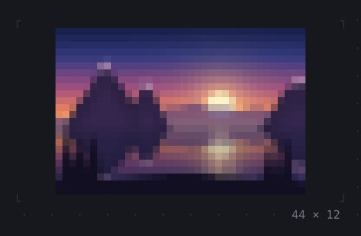

# Images

PNG, JPEG, GIF and APNG pictures, in the terminal’s graphics or in block characters.

[All groups](README.md)

| | |
| --- | --- |
|  **[Image](images/image.md)** A PNG, JPEG, GIF or APNG fitted to its cells: placed with the terminal's graphics protocol (kitty, sixel, iTerm2), or drawn in blocks (sextants where the terminal draws them, else half blocks) where it has none. In `twk_rich`. |  |

