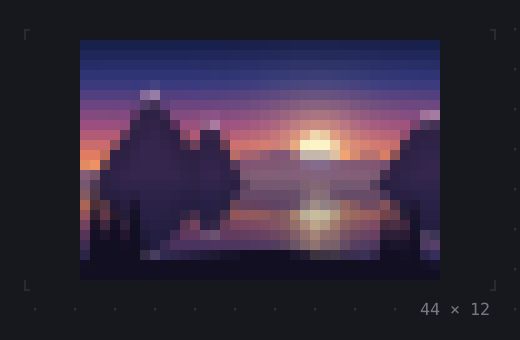
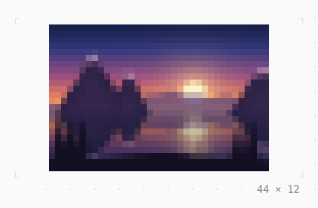

# Image

A PNG or JPEG fitted to its cells. Where the terminal has a graphics protocol (kitty, sixel, iTerm2) its pixels are placed over the cells; where it has none, or with forceBlocks, as here, it is drawn in half blocks or quadrants.

| Dark | Light |
| --- | --- |
|  |  |

In [twk_rich](../../../packages/twk_rich/README.md), besides twk.

## Code

The Dart that builds it, as the gallery's Code tab shows it with the
options as they start:

```dart
@override
Widget build(BuildContext context) => Image.file(
  'assets/lake.jpg', // 240 × 160 pixels
  width: 44,
  height: 12,
  // in blocks wherever it runs; without it the terminal's graphics
  // protocol where it has one: kitty, sixel or iTerm2
  forceBlocks: true,
);
```

## Options

What the gallery lets you change, and what each starts at:

| option | values | starts at |
| --- | --- | --- |
| picture | lake.jpg, logo.png | lake.jpg |
| fit | contain, cover, fill, scaleDown | contain |
| alignment | center, topLeft, centerLeft, centerRight, bottomRight | center |
| blocks | half, quadrant | half |
| width | 8 cells to 80 cells | 44 |
| height | 3 rows to 30 rows | 12 |

## More

- Live in the gallery:
  `dart run packages/gallery/bin/gallery.dart --route='#/images/image'`.
- [Images](../images.md) · [All groups](../README.md)
