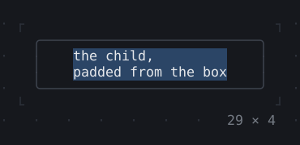
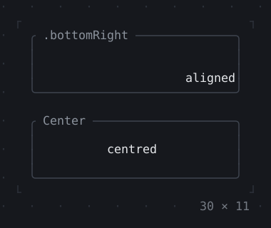
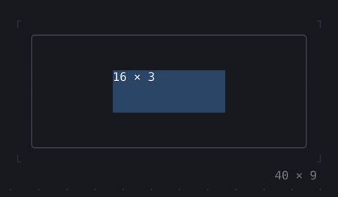
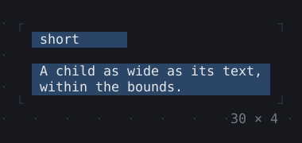
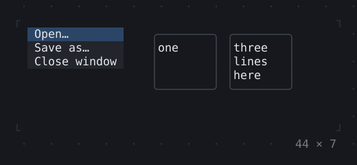
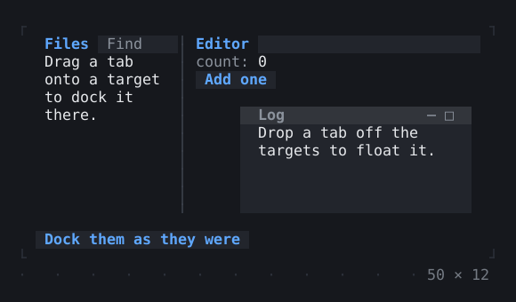
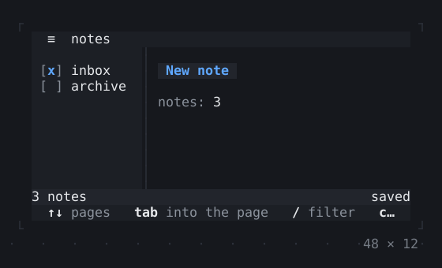

# Layout

Boxes, rows and columns, stacks, grids and wraps: where a child goes and how much room it gets.

[All groups](README.md)

| | |
| --- | --- |
|  **[Box](layout/box.md)** A border, titles on it, padding and a background around a child. |  **[ColoredBox, DecoratedBox](layout/coloredbox-decoratedbox.md)** A child's cells filled with a color, and a BoxDecoration (a fill, a border, titles) drawn under the child or over its edges. |
|  **[Container](layout/container.md)** Align, Padding, a color or a decoration, a size and a margin put together around one child, as Flutter's Container puts them. |  **[Divider](layout/divider.md)** A line across, and a VerticalDivider down; merged, they join the lines drawn before them where they meet. |
|  **[Shadow](layout/shadow.md)** A drop shadow: the cells beside and below a child, moved by its offset, what is under them darkened. |  **[Padding](layout/padding.md)** Empty cells around a child. |
|  **[Align, Center](layout/align-center.md)** A child placed in the room it is given; Center in the middle of it. |  **[SizedBox](layout/sizedbox.md)** A child of a size: SizedBox.expand fills the room, SizedBox.shrink takes none. |
|  **[ConstrainedBox](layout/constrainedbox.md)** Constraints a child is laid out within, merged with those it is given. |  **[LimitedBox, OverflowBox](layout/limitedbox-overflowbox.md)** Other constraints than the room gives: LimitedBox limits a child only where the room has no limit, OverflowBox and SizedOverflowBox give it others in its place, cut off where it sticks out. |
|  **[FractionallySizedBox](layout/fractionallysizedbox.md)** A child a fraction of the room it is given. |  **[IntrinsicWidth/Height](layout/intrinsicwidth-height.md)** A child as wide or as tall as it would like to be: stretched items all as wide as the widest, boxes all as tall as the tallest. |
|  **[Row, Column, Flex](layout/row-column-flex.md)** Children one after another along an axis, aligned along and across it. |  **[Expanded, Spacer](layout/expanded-spacer.md)** Children of a Row or Column that share the room the others leave by their flex factors: Expanded fills its share, a Flexible may take less, a Spacer is empty. |
|  **[Stack, Positioned](layout/stack-positioned.md)** Children over one another, pinned to the edges or aligned. |  **[Transform](layout/transform.md)** A child shown moved by whole cells, laid out where it was: Transform.translate, the one transform a terminal has. |
|  **[Visibility, Offstage](layout/visibility-offstage.md)** A child hidden: Offstage keeps it laid out and running without painting it; Visibility takes its room away too, or keeps it. |  **[ExpansionTile, Accordion](layout/expansiontile-accordion.md)** Sections that fold under their headers: Enter, Space or a click opens one, Right and Left open and close it; in an accordion one is open at a time, Up and Down go from header to header. |
|  **[Grid, GridPlacement](layout/grid-gridplacement.md)** Children in the cells of tracks: fixed, a share of the rest, or as long as their content; a child may span several. |  **[Wrap](layout/wrap.md)** Children in runs that go on in the next run where they would not fit: tags, buttons and key hints on a terminal that narrows. |
|  **[CustomPaint](layout/custompaint.md)** Cells a CellPainter draws itself, under the child or over it, painted again when what it paints changes. |  **[SplitView](layout/splitview.md)** Panes the mouse or the arrows resize by their dividers; Tab focuses one. The last one collapses. |
|  **[DockArea](layout/dockarea.md)** Panels in splits and tabs: a tab dragged onto a target of a group docks its panel there, and dropped elsewhere floats it; a window's title bar dragged onto one docks it again. |  **[Scaffold](layout/scaffold.md)** An app's frame: a header, a sidebar beside the body, a status bar and the key hints, each part a zone of the focus; the sidebar collapsed on a narrow screen and resized by a drag. |

