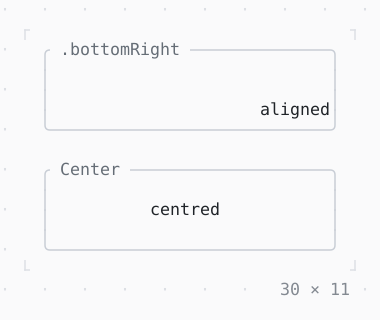

# Align, Center

A child placed in the room it is given; Center in the middle of it.

| Dark | Light |
| --- | --- |
|  |  |

## Code

The Dart that builds it, as the gallery's Code tab shows it with the
options as they start:

```dart
final theme = Theme.of(context);
Widget room(String title, Widget child) => SizedBox(
  width: 30,
  height: 5,
  child: Box(
    border: .all(type: .rounded, style: theme.border),
    titles: [BorderTitle(' $title ', style: theme.muted)],
    child: child,
  ),
);
return Column(
  mainAxisSize: .min,
  gap: 1,
  children: [
    room('.bottomRight', const Align(
      alignment: .bottomRight,
      child: Text('aligned'),
    )),
    room('Center', const Center(child: Text('centred'))),
  ],
);
```

## Options

What the gallery lets you change, and what each starts at:

| option | values | starts at |
| --- | --- | --- |
| alignment x | left, center, right | right |
| alignment y | top, center, bottom | bottom |
| width factor | none, 1, 2, 3 | none |
| height factor | none, 1, 2, 3 | none |

## More

- API: [`Align`](https://pub.dev/documentation/twk/latest/twk/Align-class.html), [`Center`](https://pub.dev/documentation/twk/latest/twk/Center-class.html).
- Also in Layout: [Box](box.md), [ColoredBox, DecoratedBox](coloredbox-decoratedbox.md), [Container](container.md), [Divider](divider.md), [Shadow](shadow.md), [Padding](padding.md), [SizedBox](sizedbox.md), [ConstrainedBox](constrainedbox.md), [LimitedBox, OverflowBox](limitedbox-overflowbox.md), [FractionallySizedBox](fractionallysizedbox.md), [IntrinsicWidth/Height](intrinsicwidth-height.md), [Row, Column, Flex](row-column-flex.md), [Expanded, Spacer](expanded-spacer.md), [Stack, Positioned](stack-positioned.md), [Transform](transform.md), [Visibility, Offstage](visibility-offstage.md), [ExpansionTile, Accordion](expansiontile-accordion.md), [Grid, GridPlacement](grid-gridplacement.md), [Wrap](wrap.md), [CustomPaint](custompaint.md), [SplitView](splitview.md), [DockArea](dockarea.md), [Scaffold](scaffold.md).
- Live in the gallery:
  `dart run packages/gallery/bin/gallery.dart --route='#/layout/align-center'`.
- [Layout](../layout.md) · [All groups](../README.md)
