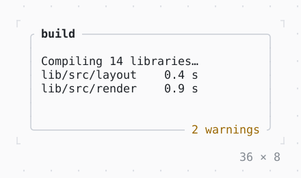

# Box

A border, titles on it, padding and a background around a child.

| Dark | Light |
| --- | --- |
|  |  |

## Code

The Dart that builds it, as the gallery's Code tab shows it with the
options as they start:

```dart
final theme = Theme.of(context);
return SizedBox(
  width: 36,
  height: 8,
  child: Box(
    border: .all(type: .rounded, style: theme.border),
    titles: [
      BorderTitle(
        ' build ',
        style: theme.text.merge(const .new(attrs: Attr.bold)),
      ),
      BorderTitle(
        ' 2 warnings ',
        style: theme.warning,
        alignment: .bottomRight,
      ),
    ],
    padding: const .all(1),
    child: const Text(
      'Compiling 14 libraries…\n'
      'lib/src/layout    0.4 s\n'
      'lib/src/render    0.9 s',
    ),
  ),
);
```

## Options

What the gallery lets you change, and what each starts at:

| option | values | starts at |
| --- | --- | --- |
| border | single, rounded, double, heavy, ascii, none | rounded |
| sides | all, top bottom, top left, left | all |
| titles | on, off | true |
| title at | topLeft, topCenter, topRight, bottomLeft, bottomCenter | topLeft |
| padding | 0, 1, 2 | 1 |
| surface | on, off | false |

## More

- API: [`Box`](https://pub.dev/documentation/twk/latest/twk/Box-class.html).
- Also in Layout: [ColoredBox, DecoratedBox](coloredbox-decoratedbox.md), [Container](container.md), [Divider](divider.md), [Shadow](shadow.md), [Padding](padding.md), [Align, Center](align-center.md), [SizedBox](sizedbox.md), [ConstrainedBox](constrainedbox.md), [LimitedBox, OverflowBox](limitedbox-overflowbox.md), [FractionallySizedBox](fractionallysizedbox.md), [IntrinsicWidth/Height](intrinsicwidth-height.md), [Row, Column, Flex](row-column-flex.md), [Expanded, Spacer](expanded-spacer.md), [Stack, Positioned](stack-positioned.md), [Transform](transform.md), [Visibility, Offstage](visibility-offstage.md), [ExpansionTile, Accordion](expansiontile-accordion.md), [Grid, GridPlacement](grid-gridplacement.md), [Wrap](wrap.md), [CustomPaint](custompaint.md), [SplitView](splitview.md), [DockArea](dockarea.md), [Scaffold](scaffold.md).
- Live in the gallery:
  `dart run packages/gallery/bin/gallery.dart --route='#/layout/box'`.
- [Layout](../layout.md) · [All groups](../README.md)
