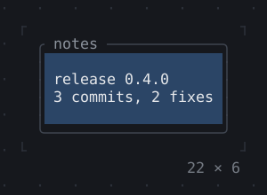
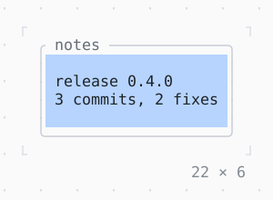

# ColoredBox, DecoratedBox

A child's cells filled with a color, and a BoxDecoration (a fill, a border, titles) drawn under the child or over its edges.

| Dark | Light |
| --- | --- |
|  |  |

## Code

The Dart that builds it, as the gallery's Code tab shows it with the
options as they start:

```dart
final theme = Theme.of(context);
return DecoratedBox(
  decoration: BoxDecoration(
    border: .all(type: .rounded, style: theme.border),
    titles: [BorderTitle(' notes ', style: theme.muted)],
  ),
  child: ColoredBox(
    color: theme.selection.bg!,
    child: const Padding(
      padding: .all(1),
      child: Text('release 0.4.0\n3 commits, 2 fixes'),
    ),
  ),
);
```

## Options

What the gallery lets you change, and what each starts at:

| option | values | starts at |
| --- | --- | --- |
| position | background, foreground | background |
| fill | ColoredBox, gradient | ColoredBox |
| border | single, rounded, double, heavy, ascii | rounded |
| titles | on, off | true |

## More

- API: [`ColoredBox`](https://pub.dev/documentation/twk/latest/twk/ColoredBox-class.html), [`DecoratedBox`](https://pub.dev/documentation/twk/latest/twk/DecoratedBox-class.html).
- Also in Layout: [Box](box.md), [Container](container.md), [Divider](divider.md), [Shadow](shadow.md), [Padding](padding.md), [Align, Center](align-center.md), [SizedBox](sizedbox.md), [ConstrainedBox](constrainedbox.md), [LimitedBox, OverflowBox](limitedbox-overflowbox.md), [FractionallySizedBox](fractionallysizedbox.md), [IntrinsicWidth/Height](intrinsicwidth-height.md), [Row, Column, Flex](row-column-flex.md), [Expanded, Spacer](expanded-spacer.md), [Stack, Positioned](stack-positioned.md), [Transform](transform.md), [Visibility, Offstage](visibility-offstage.md), [ExpansionTile, Accordion](expansiontile-accordion.md), [Grid, GridPlacement](grid-gridplacement.md), [Wrap](wrap.md), [CustomPaint](custompaint.md), [SplitView](splitview.md), [DockArea](dockarea.md), [Scaffold](scaffold.md).
- Live in the gallery:
  `dart run packages/gallery/bin/gallery.dart --route='#/layout/coloredbox-decoratedbox'`.
- [Layout](../layout.md) · [All groups](../README.md)
