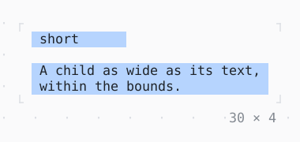

# ConstrainedBox

Constraints a child is laid out within, merged with those it is given.

| Dark | Light |
| --- | --- |
|  |  |

## Code

The Dart that builds it, as the gallery's Code tab shows it with the
options as they start:

```dart
final theme = Theme.of(context);
Widget bounded(String text) => ConstrainedBox(
  constraints: const BoxConstraints(12, 32, 1, 3),
  child: Box(
    style: theme.selection,
    padding: const .x(1),
    child: Text(text),
  ),
);
return Column(
  mainAxisSize: .min,
  crossAxisAlignment: .start,
  gap: 1,
  children: [
    bounded('short'),
    bounded('A child as wide as its text, within the bounds.'),
  ],
);
```

## Options

What the gallery lets you change, and what each starts at:

| option | values | starts at |
| --- | --- | --- |
| min width | 0, 12, 20 | 12 |
| max width | 20, 32, 48 | 32 |

## More

- API: [`ConstrainedBox`](https://pub.dev/documentation/twk/latest/twk/ConstrainedBox-class.html).
- Also in Layout: [Box](box.md), [ColoredBox, DecoratedBox](coloredbox-decoratedbox.md), [Container](container.md), [Divider](divider.md), [Shadow](shadow.md), [Padding](padding.md), [Align, Center](align-center.md), [SizedBox](sizedbox.md), [LimitedBox, OverflowBox](limitedbox-overflowbox.md), [FractionallySizedBox](fractionallysizedbox.md), [IntrinsicWidth/Height](intrinsicwidth-height.md), [Row, Column, Flex](row-column-flex.md), [Expanded, Spacer](expanded-spacer.md), [Stack, Positioned](stack-positioned.md), [Transform](transform.md), [Visibility, Offstage](visibility-offstage.md), [ExpansionTile, Accordion](expansiontile-accordion.md), [Grid, GridPlacement](grid-gridplacement.md), [Wrap](wrap.md), [CustomPaint](custompaint.md), [SplitView](splitview.md), [DockArea](dockarea.md), [Scaffold](scaffold.md).
- Live in the gallery:
  `dart run packages/gallery/bin/gallery.dart --route='#/layout/constrainedbox'`.
- [Layout](../layout.md) · [All groups](../README.md)
