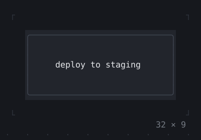
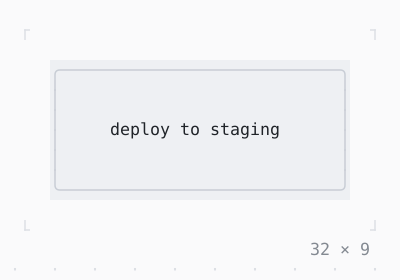

# Container

Align, Padding, a color or a decoration, a size and a margin put together around one child, as Flutter's Container puts them.

| Dark | Light |
| --- | --- |
|  |  |

## Code

The Dart that builds it, as the gallery's Code tab shows it with the
options as they start:

```dart
final theme = Theme.of(context);
return Container(
  width: 30,
  height: 7,
  margin: const .all(1),
  padding: const .all(1),
  alignment: .center,
  decoration: BoxDecoration(
    style: theme.surface,
    border: .all(type: .rounded, style: theme.border),
  ),
  child: const Text('deploy to staging'),
);
```

## Options

What the gallery lets you change, and what each starts at:

| option | values | starts at |
| --- | --- | --- |
| fill | decoration, color | decoration |
| alignment | none, topLeft, center, bottomRight | center |
| width | none, 24, 30, 36 | 30 |
| height | none, 5, 7, 9 | 7 |
| padding | 0, 1, 2 | 1 |
| margin | 0, 1, 2 | 1 |
| foreground | on, off | false |

## More

- API: [`Container`](https://pub.dev/documentation/twk/latest/twk/Container-class.html).
- Also in Layout: [Box](box.md), [ColoredBox, DecoratedBox](coloredbox-decoratedbox.md), [Divider](divider.md), [Shadow](shadow.md), [Padding](padding.md), [Align, Center](align-center.md), [SizedBox](sizedbox.md), [ConstrainedBox](constrainedbox.md), [LimitedBox, OverflowBox](limitedbox-overflowbox.md), [FractionallySizedBox](fractionallysizedbox.md), [IntrinsicWidth/Height](intrinsicwidth-height.md), [Row, Column, Flex](row-column-flex.md), [Expanded, Spacer](expanded-spacer.md), [Stack, Positioned](stack-positioned.md), [Transform](transform.md), [Visibility, Offstage](visibility-offstage.md), [ExpansionTile, Accordion](expansiontile-accordion.md), [Grid, GridPlacement](grid-gridplacement.md), [Wrap](wrap.md), [CustomPaint](custompaint.md), [SplitView](splitview.md), [DockArea](dockarea.md), [Scaffold](scaffold.md).
- Live in the gallery:
  `dart run packages/gallery/bin/gallery.dart --route='#/layout/container'`.
- [Layout](../layout.md) · [All groups](../README.md)
