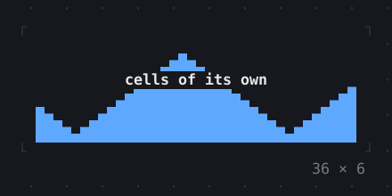
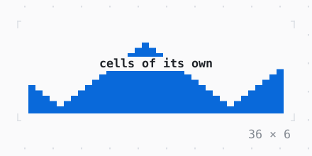

# CustomPaint

Cells a CellPainter draws itself, under the child or over it, painted again when what it paints changes.

| Dark | Light |
| --- | --- |
|  |  |

## Code

The Dart that builds it, as the gallery's Code tab shows it with the
options as they start:

```dart
final _phase = ValueNotifier(0);
late final Timer _timer;

@override
void initState() {
  super.initState();
  _timer = Timer.periodic(
    const Duration(milliseconds: 100),
    (_) => _phase.value++,
  );
}

@override
void dispose() {
  _timer.cancel();
  _phase.dispose();
  super.dispose();
}

@override
Widget build(BuildContext context) {
  final theme = Theme.of(context);
  return CustomPaint(
    painter: WavePainter(_phase, theme.primary),
    child: SizedBox(
      width: 36,
      height: 6,
      child: Center(
        child: Text(
          'cells of its own',
          style: theme.text.merge(const .new(attrs: Attr.bold)),
        ),
      ),
    ),
  );
}

/// Blocks as high as a wave 24 columns long, moved along by [phase]
/// with no widget built again.
final class WavePainter extends CellPainter {
  WavePainter(this.phase, this.style) : super(repaint: phase);

  final ValueNotifier<int> phase;
  final Style style;

  @override
  void paint(Canvas canvas, int width, int height) {
    final pen = style.penIn(canvas.styles);
    for (var x = 0; x < width; x++) {
      final u = (x + phase.value) % 24;
      final eighths = 4 + 3 * (u < 12 ? u : 24 - u);
      for (var row = 0; row < height; row++) {
        final left = eighths - 8 * row;
        if (left > 0) {
          canvas.text(x, height - 1 - row, ' ▁▂▃▄▅▆▇█'[min(left, 8)], pen);
        }
      }
    }
  }

  @override
  bool shouldRepaint(WavePainter oldDelegate) =>
      oldDelegate.phase != phase || oldDelegate.style != style;
}
```

## Options

What the gallery lets you change, and what each starts at:

| option | values | starts at |
| --- | --- | --- |
| painter | painter, foregroundPainter | painter |
| moving | on, off | true |
| style | primary, accent, success | primary |

## More

- API: [`CustomPaint`](https://pub.dev/documentation/twk/latest/twk/CustomPaint-class.html).
- Also in Layout: [Box](box.md), [ColoredBox, DecoratedBox](coloredbox-decoratedbox.md), [Container](container.md), [Divider](divider.md), [Shadow](shadow.md), [Padding](padding.md), [Align, Center](align-center.md), [SizedBox](sizedbox.md), [ConstrainedBox](constrainedbox.md), [LimitedBox, OverflowBox](limitedbox-overflowbox.md), [FractionallySizedBox](fractionallysizedbox.md), [IntrinsicWidth/Height](intrinsicwidth-height.md), [Row, Column, Flex](row-column-flex.md), [Expanded, Spacer](expanded-spacer.md), [Stack, Positioned](stack-positioned.md), [Transform](transform.md), [Visibility, Offstage](visibility-offstage.md), [ExpansionTile, Accordion](expansiontile-accordion.md), [Grid, GridPlacement](grid-gridplacement.md), [Wrap](wrap.md), [SplitView](splitview.md), [DockArea](dockarea.md), [Scaffold](scaffold.md).
- Live in the gallery:
  `dart run packages/gallery/bin/gallery.dart --route='#/layout/custompaint'`.
- [Layout](../layout.md) · [All groups](../README.md)
