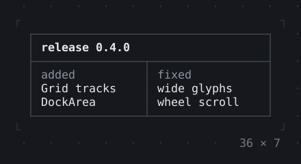
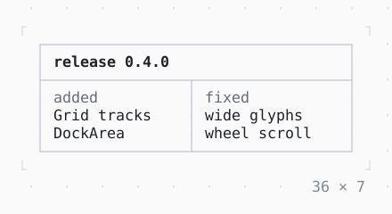

# Divider

A line across, and a VerticalDivider down; merged, they join the lines drawn before them where they meet.

| Dark | Light |
| --- | --- |
|  |  |

## Code

The Dart that builds it, as the gallery's Code tab shows it with the
options as they start:

```dart
final theme = Theme.of(context);
return SizedBox(
  width: 36,
  height: 7,
  child: Stack(
    fit: .expand,
    children: [
      Box(border: .all(style: theme.border)),
      const Positioned(
        left: 2,
        top: 1,
        child: Text('release 0.4.0', style: .new(attrs: Attr.bold)),
      ),
      Positioned(
        left: 0,
        right: 0,
        top: 2,
        child: Divider(style: theme.border, merge: true),
      ),
      Positioned(
        left: 17,
        top: 2,
        bottom: 0,
        child: VerticalDivider(style: theme.border, merge: true),
      ),
      Positioned(left: 2, top: 3, child: Text('added', style: theme.muted)),
      const Positioned(left: 2, top: 4, child: Text('Grid tracks\nDockArea')),
      Positioned(left: 19, top: 3, child: Text('fixed', style: theme.muted)),
      const Positioned(
        left: 19,
        top: 4,
        child: Text('wide glyphs\nwheel scroll'),
      ),
    ],
  ),
);
```

## Options

What the gallery lets you change, and what each starts at:

| option | values | starts at |
| --- | --- | --- |
| type | single, rounded, double, heavy, ascii | single |
| merge | on, off | true |

## More

- API: [`Divider`](https://pub.dev/documentation/twk/latest/twk/Divider-class.html).
- Also in Layout: [Box](box.md), [ColoredBox, DecoratedBox](coloredbox-decoratedbox.md), [Container](container.md), [Shadow](shadow.md), [Padding](padding.md), [Align, Center](align-center.md), [SizedBox](sizedbox.md), [ConstrainedBox](constrainedbox.md), [LimitedBox, OverflowBox](limitedbox-overflowbox.md), [FractionallySizedBox](fractionallysizedbox.md), [IntrinsicWidth/Height](intrinsicwidth-height.md), [Row, Column, Flex](row-column-flex.md), [Expanded, Spacer](expanded-spacer.md), [Stack, Positioned](stack-positioned.md), [Transform](transform.md), [Visibility, Offstage](visibility-offstage.md), [ExpansionTile, Accordion](expansiontile-accordion.md), [Grid, GridPlacement](grid-gridplacement.md), [Wrap](wrap.md), [CustomPaint](custompaint.md), [SplitView](splitview.md), [DockArea](dockarea.md), [Scaffold](scaffold.md).
- Live in the gallery:
  `dart run packages/gallery/bin/gallery.dart --route='#/layout/divider'`.
- [Layout](../layout.md) · [All groups](../README.md)
