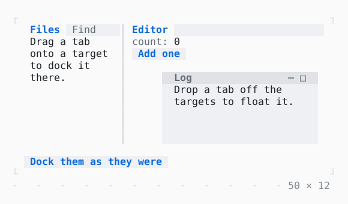

# DockArea

Panels in splits and tabs: a tab dragged onto a target of a group docks its panel there, and dropped elsewhere floats it; a window's title bar dragged onto one docks it again.

| Dark | Light |
| --- | --- |
|  |  |

## Code

The Dart that builds it, as the gallery's Code tab shows it with the
options as they start:

```dart
final _dock = DockController(_docked());

static DockLayout _docked() => DockLayout(
  root: DockSplit(
    .horizontal,
    [
      DockTabs(['files', 'find']),
      DockTabs(['editor']),
    ],
    fractions: [1, 2],
  ),
  windows: const [DockWindow('log', left: 23, top: 4, width: 26, height: 6)],
);

@override
void dispose() {
  _dock.dispose();
  super.dispose();
}

@override
Widget build(BuildContext context) => Column(
  mainAxisSize: .min,
  crossAxisAlignment: .start,
  gap: 1,
  children: [
    SizedBox(
      width: 50,
      height: 10,
      child: DockArea(
        controller: _dock,
        panels: const [
          DockPanel(
            id: 'files',
            title: 'Files',
            child: Padding(
              padding: .x(1),
              child: Text('Drag a tab onto a target to dock it there.'),
            ),
          ),
          DockPanel(
            id: 'find',
            title: 'Find',
            child: Padding(padding: .x(1), child: Text('Find in files.')),
          ),
          DockPanel(
            id: 'editor',
            title: 'Editor',
            child: Padding(padding: .x(1), child: _Clicks()),
          ),
          DockPanel(
            id: 'log',
            title: 'Log',
            child: Padding(
              padding: .x(1),
              child: Text('Drop a tab off the targets to float it.'),
            ),
          ),
        ],
      ),
    ),
    Button(
      'Dock them as they were',
      onPressed: () => _dock.layout = _docked(),
    ),
  ],
);

/// A count and a button that adds to it: kept as its panel moves.
final class _Clicks extends StatefulWidget {
  const _Clicks();

  @override
  State<_Clicks> createState() => _ClicksState();
}

final class _ClicksState extends State<_Clicks> {
  var _count = 0;

  @override
  Widget build(BuildContext context) {
    final theme = Theme.of(context);
    return Column(
      crossAxisAlignment: .start,
      children: [
        Text.rich([Span('count: ', theme.muted), Span('$_count')]),
        Button('Add one', onPressed: () => setState(() => _count++)),
      ],
    );
  }
}
```

## Options

What the gallery lets you change, and what each starts at:

| option | values | starts at |
| --- | --- | --- |
| tab strip | on, off | true |
| window frame | by the theme, raised, bordered | by the theme |

## More

- API: [`DockArea`](https://pub.dev/documentation/twk/latest/twk/DockArea-class.html).
- Also in Layout: [Box](box.md), [ColoredBox, DecoratedBox](coloredbox-decoratedbox.md), [Container](container.md), [Divider](divider.md), [Shadow](shadow.md), [Padding](padding.md), [Align, Center](align-center.md), [SizedBox](sizedbox.md), [ConstrainedBox](constrainedbox.md), [LimitedBox, OverflowBox](limitedbox-overflowbox.md), [FractionallySizedBox](fractionallysizedbox.md), [IntrinsicWidth/Height](intrinsicwidth-height.md), [Row, Column, Flex](row-column-flex.md), [Expanded, Spacer](expanded-spacer.md), [Stack, Positioned](stack-positioned.md), [Transform](transform.md), [Visibility, Offstage](visibility-offstage.md), [ExpansionTile, Accordion](expansiontile-accordion.md), [Grid, GridPlacement](grid-gridplacement.md), [Wrap](wrap.md), [CustomPaint](custompaint.md), [SplitView](splitview.md), [Scaffold](scaffold.md).
- Live in the gallery:
  `dart run packages/gallery/bin/gallery.dart --route='#/layout/dockarea'`.
- [Layout](../layout.md) · [All groups](../README.md)
