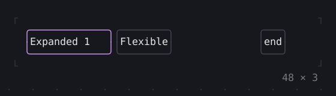
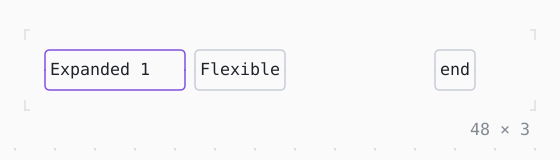

# Expanded, Spacer

Children of a Row or Column that share the room the others leave by their flex factors: Expanded fills its share, a Flexible may take less, a Spacer is empty.

| Dark | Light |
| --- | --- |
|  |  |

## Code

The Dart that builds it, as the gallery's Code tab shows it with the
options as they start:

```dart
final theme = Theme.of(context);
return SizedBox(
  width: 48,
  height: 3,
  child: Row(
    crossAxisAlignment: .stretch,
    children: [
      Expanded(
        child: Box(
          border: .all(type: .rounded, style: theme.accent),
          child: const Text('Expanded 1', wrap: .none),
        ),
      ),
      Flexible(
        child: Box(
          border: .all(type: .rounded, style: theme.border),
          child: const Text('Flexible'),
        ),
      ),
      const Spacer(),
      Box(
        border: .all(type: .rounded, style: theme.border),
        child: const Text('end'),
      ),
    ],
  ),
);
```

## Options

What the gallery lets you change, and what each starts at:

| option | values | starts at |
| --- | --- | --- |
| Expanded flex | 1, 2, 3 | 1 |
| Flexible fit | loose, tight | loose |
| width | 20 cells to 50 cells | 48 |

## More

- API: [`Expanded`](https://pub.dev/documentation/twk/latest/twk/Expanded-class.html), [`Spacer`](https://pub.dev/documentation/twk/latest/twk/Spacer-class.html).
- Also in Layout: [Box](box.md), [ColoredBox, DecoratedBox](coloredbox-decoratedbox.md), [Container](container.md), [Divider](divider.md), [Shadow](shadow.md), [Padding](padding.md), [Align, Center](align-center.md), [SizedBox](sizedbox.md), [ConstrainedBox](constrainedbox.md), [LimitedBox, OverflowBox](limitedbox-overflowbox.md), [FractionallySizedBox](fractionallysizedbox.md), [IntrinsicWidth/Height](intrinsicwidth-height.md), [Row, Column, Flex](row-column-flex.md), [Stack, Positioned](stack-positioned.md), [Transform](transform.md), [Visibility, Offstage](visibility-offstage.md), [ExpansionTile, Accordion](expansiontile-accordion.md), [Grid, GridPlacement](grid-gridplacement.md), [Wrap](wrap.md), [CustomPaint](custompaint.md), [SplitView](splitview.md), [DockArea](dockarea.md), [Scaffold](scaffold.md).
- Live in the gallery:
  `dart run packages/gallery/bin/gallery.dart --route='#/layout/expanded-spacer'`.
- [Layout](../layout.md) · [All groups](../README.md)
